# 🍽️ Smart Restaurant SaaS — QR Ordering & Floor Operations Platform

[](https://nodejs.org/)
[](https://www.typescriptlang.org/)
[](https://expressjs.com/)
[](https://react.dev/)
[](https://vitejs.dev/)
[](https://tailwindcss.com/)
[](https://supabase.com/)

> A multi-tenant restaurant platform in which a guest scans a table QR code, orders from their phone, and the order flows to the **kitchen display**, the **waiter's floor view**, and the **manager's console** — while a single, consistent **table bill** tracks every rupee ordered, paid and still owed. One platform owner (**DevAdmin**) can host any number of independent restaurants on it.

This document describes the system **exactly as implemented in the source code**. Every diagram below reflects real code paths (file names are given so you can verify them).

---

## 📑 Table of Contents

1. [What the system does](#1--what-the-system-does)
2. [Technology stack](#2--technology-stack)
3. [Repository structure](#3--repository-structure)
4. [System architecture](#4--system-architecture)
5. [Multi-tenancy & request pipeline](#5--multi-tenancy--request-pipeline)
6. [Roles & permissions](#6--roles--permissions)
7. [End-to-end order flow](#7--end-to-end-order-flow)
8. [Order, ticket & kitchen state machines](#8--order-ticket--kitchen-state-machines)
9. [Table sessions & floor lifecycle](#9--table-sessions--floor-lifecycle)
10. [Money flow: billing, payments & loyalty](#10--money-flow-billing-payments--loyalty)
11. [Screens & how each role uses them](#11--screens--how-each-role-uses-them)
12. [Database design](#12--database-design)
13. [File storage](#13--file-storage)
14. [API reference](#14--api-reference)
15. [Getting started (local)](#15--getting-started-local)
16. [Production deployment](#16--production-deployment)
17. [Demo data & credentials](#17--demo-data--credentials)
18. [Testing](#18--testing)
19. [Known limitations & production-hardening checklist](#19--known-limitations--production-hardening-checklist)
20. [Troubleshooting & FAQ](#20--troubleshooting--faq)

---

## 1. 🧭 What the system does

| Actor | What they do in the system |
|---|---|
| **Guest (customer)** | Scans a table QR (or picks a table manually), browses the menu, customises dishes (portion variants + modifiers), checks out with a mobile number, tracks each order live, calls the waiter, views the running bill, pays online, and opens/prints a receipt. Can also place **takeaway** orders. |
| **Kitchen** | Sees a live queue of tickets (no prices, no customer data), taps **Start Cooking** → **Mark Ready**, or voids a ticket. A chime plays when new tickets arrive. |
| **Waiter** | Sees the floor map, ready-to-serve dishes, guest service calls and each table's live bill. Delivers food, places orders on a guest's behalf (POS), generates the bill, collects **cash / UPI / card**, prints receipts, and resets tables. |
| **Manager** | Builds the menu (categories, dishes, variants, modifiers, photos, sold-out toggle), manages tables and printable QR codes, manages staff accounts, and reads sales analytics and the loyalty ledger. |
| **DevAdmin (platform owner)** | Provisions new restaurants (tenant + settings + first manager), suspends / reactivates / deletes tenants, and reads platform-wide stats and the audit log. |

**Core design ideas**

- **One tenant = one restaurant.** Every business table carries `restaurant_id`; every query is scoped by it.
- **The server is the source of truth for money.** Client prices are ignored; the API re-reads every price from the database on checkout.
- **One bill per table session.** All rounds of ordering at a table land on a single bill whose total grows as dishes are added; payments are tracked against it so nobody pays twice.
- **Immutable snapshots.** Order lines store the dish/variant/modifier names and prices *as ordered*, so later menu edits never rewrite history.
- **Polling, not websockets.** Screens refresh by short-interval HTTP polling (see [§11](#polling-intervals)).

---

## 2. 🧰 Technology stack

| Layer | Technology | Notes |
|---|---|---|
| Frontend | React 18, React Router 6, Vite 6, TypeScript, Tailwind CSS 3 (`darkMode: 'class'`), `lucide-react`, `canvas-confetti` | Single SPA serving customer, staff and DevAdmin UIs |
| Backend | Node.js, Express 4, TypeScript (ESM / `NodeNext`), `zod` validation | Modular routers, one folder per domain |
| Auth | `jsonwebtoken` (HS256, signed with `SESSION_SECRET`), `bcryptjs` | Staff JWT = 24 h, DevAdmin JWT = 7 d |
| Database | PostgreSQL (hosted on Supabase) via `pg` connection pool (max 20, SSL) | Transactions through `withTransaction()` |
| Storage | Supabase Storage (`menu-items` bucket) via `@supabase/supabase-js` | Used **only** for dish photos |
| QR codes | `qrcode` (server-side PNG data-URL, error-correction `H`) | Tinted with the restaurant's brand colour |
| Tooling | npm workspaces, `tsx`, `concurrently` | `apps/api` + `apps/website` |

---

## 3. 🗂️ Repository structure

```text
.
├── package.json                      # npm workspaces root (dev / build / test scripts)
├── supabase/
│   └── migrations/
│       └── 20261109000001_initial_schema.sql   # all 23 tables, constraints, indexes
└── apps/
    ├── api/                          # Express + TypeScript backend  (port 5000)
    │   └── src/
    │       ├── index.ts              # app bootstrap, router mounting, error handler
    │       ├── config/env.ts         # environment variables (+ dev defaults)
    │       ├── db/
    │       │   ├── index.ts          # pg Pool, query(), withTransaction(), Supabase client
    │       │   ├── seed.ts           # base tenants, staff, menu, tables
    │       │   └── seed_more.ts      # extra dishes + tables + Urban Crust staff
    │       ├── middleware/
    │       │   ├── tenant.ts         # resolveTenant  (which restaurant is this request for?)
    │       │   └── auth.ts           # requireStaff(roles) / requireDevAdmin
    │       ├── modules/
    │       │   ├── auth/             # staff login, /me
    │       │   ├── restaurant/       # public branding, public tables, QR resolve
    │       │   ├── menu/             # public menu + manager CRUD + image upload
    │       │   ├── tables/           # floor list, create table, QR generation, reset table
    │       │   ├── orders/           # unified order service, tracking, status, delete
    │       │   ├── kitchen/          # KDS ticket feed, ticket status, void
    │       │   ├── service_requests/ # call-waiter requests
    │       │   ├── billing/          # billing.routes.ts + billing.utils.ts (the money engine)
    │       │   ├── loyalty/          # customers, points ledger, sales analytics
    │       │   ├── staff/            # manager → staff accounts
    │       │   └── devadmin/         # platform-owner API
    │       ├── types/index.ts
    │       └── test/integration.test.ts
    └── website/                      # React SPA (Vite dev server, port 5173)
        └── src/
            ├── App.tsx               # routes + guards
            ├── services/api.ts       # fetch wrapper + per-role API clients
            ├── context/              # Tenant, StaffAuth, Cart, Theme providers
            ├── components/           # FloorMap, WaiterOrderModal, ReceiptModal, SuspendedNotice, ThemeToggle
            └── pages/
                ├── customer/         # TableEntry, Menu, ItemModal, Cart, Checkout, OrderTracking, RunningBill, Receipt
                ├── kitchen/          # KitchenKDS
                ├── waiter/           # WaiterFloor
                ├── manager/          # ManagerDashboard
                ├── staff/            # Login
                └── devadmin/         # DevAdminPortal
```

---

## 4. 🏗️ System architecture

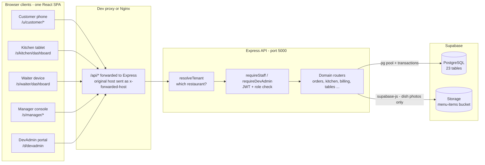

**Key architectural facts**

- The SPA calls the API at the relative path `/api/v1`. In development Vite proxies `/api` to `localhost:5000` and forwards the original `Host` as `x-forwarded-host`; in production Nginx must do the same.
- `DevAdmin` routes (`/api/v1/devadmin/*`) are **not** tenant-scoped; every other business route runs through `resolveTenant` first.
- The database is accessed with plain SQL over a `pg` pool. Supabase is used as a hosted Postgres plus Storage; the app does **not** use Supabase Auth or Realtime for its features.

---

## 5. 🏢 Multi-tenancy & request pipeline

### 5.1 How a request finds its restaurant (`middleware/tenant.ts`)

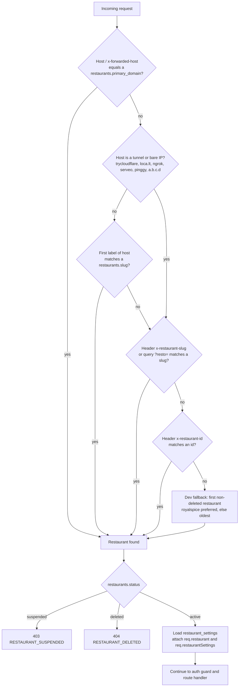

Practical consequences:

- **Production:** give each restaurant its own domain (`primary_domain`) or a subdomain equal to its `slug` (e.g. `royalspice.yourdomain.com`).
- **Local:** `*.localhost` subdomains work in modern browsers (`royalspice.localhost:5173`).
- **Phone testing through a tunnel:** the tenant is taken from `?resto=<slug>` or the slug the SPA stored in `localStorage` (`active_tenant_slug`). The SPA sends it as the `x-restaurant-slug` header on every call.
- **Suspension:** when DevAdmin suspends a restaurant, every tenant-scoped API call returns **HTTP 403** with `error: "RESTAURANT_SUSPENDED"`. The SPA's `TenantContext` detects that code and renders the full-screen `SuspendedNotice` for customers *and* staff of that restaurant. Other restaurants are unaffected. (DevAdmin routes bypass the check, so the owner can always reactivate.)

### 5.2 Authentication and authorisation

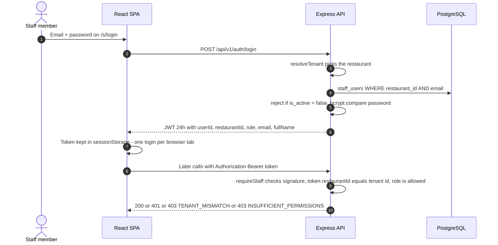

- A token issued for restaurant A is rejected at restaurant B with `TENANT_MISMATCH`.
- Staff tokens live in **`sessionStorage`**, so a kitchen tablet and a waiter phone can be logged in simultaneously in different tabs without overwriting each other.
- After login the SPA routes by role: manager → `/s/manager/dashboard`, kitchen → `/s/kitchen/dashboard`, waiter → `/s/waiter/dashboard`.
- Guests have **no accounts**. They are identified by their phone number (per restaurant) and tracked by an unguessable **order access token** (see §7).

---

## 6. 🔐 Roles & permissions

Derived from `requireStaff([...])` on each route.

| Capability | Guest | Kitchen | Waiter | Manager | DevAdmin |
|---|:--:|:--:|:--:|:--:|:--:|
| View menu, branding, tables, resolve QR | ✅ | ✅ | ✅ | ✅ | – |
| Place order (customer checkout) | ✅ | – | – | – | – |
| Place order for a guest (POS) | – | – | ✅ | ✅ | – |
| View kitchen ticket queue | – | ✅ | ✅ | ✅ | – |
| Start cooking / mark ready | – | ✅ | ✅ | ✅ | – |
| Void a kitchen ticket | – | ✅ | – | ✅ | – |
| Update order status (state machine) | – | ✅ | ✅ | ✅ | – |
| Delete an order | – | – | ✅ | ✅ | – |
| View floor map / staff order list | – | – | ✅ | ✅ | – |
| Reset a table to Available | – | – | ✅ | ✅ | – |
| View / resolve service requests | create only | – | ✅ | ✅ | – |
| Generate bill, record payments | – | – | ✅ | ✅ | – |
| Pay own bill online | ✅ | – | – | – | – |
| Menu / table / QR / staff management | – | – | – | ✅ | – |
| Sales analytics, customers, loyalty ledger | – | – | – | ✅ | – |
| Create / suspend / delete restaurants | – | – | – | – | ✅ |

The front end additionally guards routes with `ProtectedStaffRoute` (kitchen page: kitchen + manager; waiter pages: waiter + manager; manager pages: manager only).

---

## 7. 🔄 End-to-end order flow

### 7.1 One order, every actor

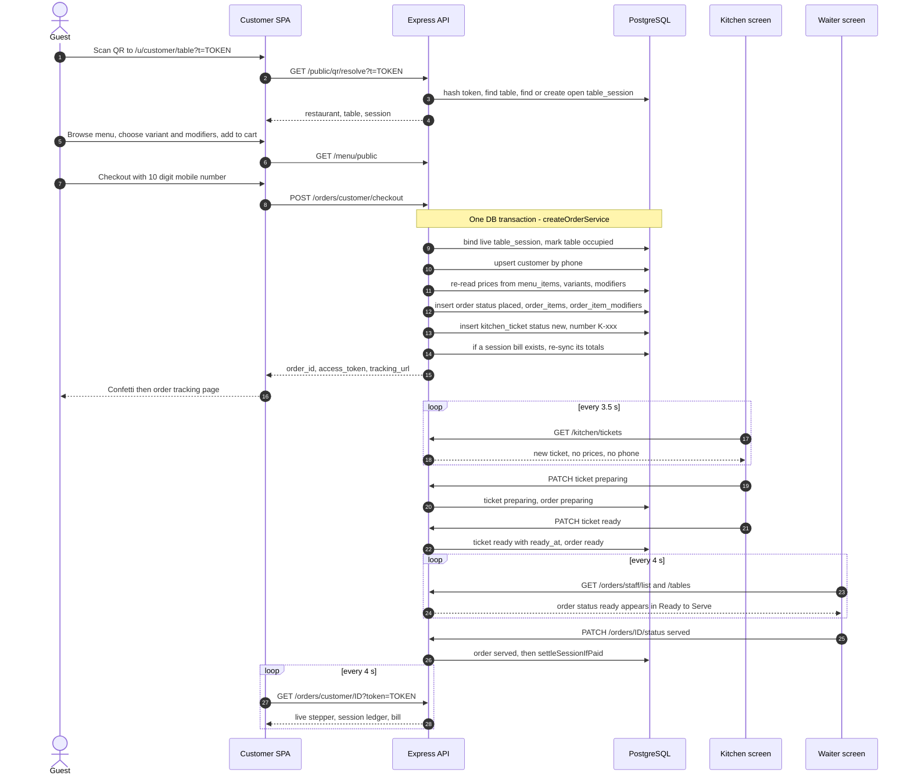

### 7.2 What `createOrderService` guarantees (`orders.routes.ts`)

Both the guest checkout and the waiter POS call **the same service**, so a waiter-placed order is indistinguishable downstream: same kitchen ticket, same table session, same bill.

1. **Table session binding (dine-in).** A hinted `table_session_id` is trusted only if it belongs to that table and is still live (`open`, `bill_requested`, `bill_generated`). Otherwise the table's active session is reused, or a new one is opened. Concurrent requests are protected by a partial unique index (one non-closed session per table). If a guest just paid and orders again within **45 minutes**, the closed session is **re-opened** so the new dish continues on the *same bill*.
2. **Customer resolution.** Phone is normalised to E.164 (default `+91`) and upserted per restaurant. If a waiter supplies no phone, the order attaches to the guest already known on that session, otherwise to the placeholder **Walk-in Guest** (`+910000000000`), which never earns loyalty and is hidden from the CRM list.
3. **Server-side pricing.** Each line's unit price = variant price (or dish base price) + sum of selected modifier prices, read from the database. Sold-out dishes and unavailable variants are rejected. Quantity is limited to 1–50.
4. **Numbering.** Order number = `#` + (100 + today's order count + 1) → `#101`, `#102` …; kitchen ticket = `K-101`, `K-102` …
5. **Tracking token.** 24 random bytes (hex) are returned **once** to the guest; only their SHA-256 hash is stored in `orders.access_token_hash`.
6. **Bill sync.** If the session already has a bill, it is recomputed from live order items (see §10).

### 7.3 Who sees what — data distribution

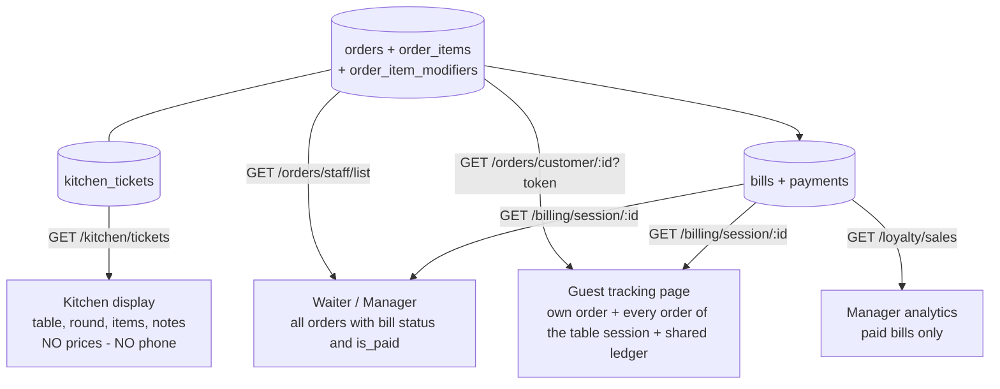

- **Round number** (Round 1, Round 2 …) is computed on the fly = position of the order within its table session among non-cancelled orders.
- The kitchen feed intentionally excludes prices, phone numbers and payment data.

### 7.4 Waiter POS order

`WaiterOrderModal` → `POST /orders/waiter/order` (roles: waiter, manager). Same payload as checkout, but phone and name are optional (a typed phone must be ≥ 10 digits; it is stored as `+91XXXXXXXXXX`). The order records `created_by_staff_id`. The waiter UI places dine-in orders; the API also accepts `takeaway`.

### 7.5 Takeaway orders

Guests can switch the cart to **Takeaway** (no table). Takeaway orders have no table session, so they get a **per-order bill** (`bills.order_id` set, `table_session_id` NULL) that includes the restaurant's **packaging charge**. Paying that bill marks the order `completed`.

---

## 8. 🍳 Order, ticket & kitchen state machines

### 8.1 Order status as it actually moves

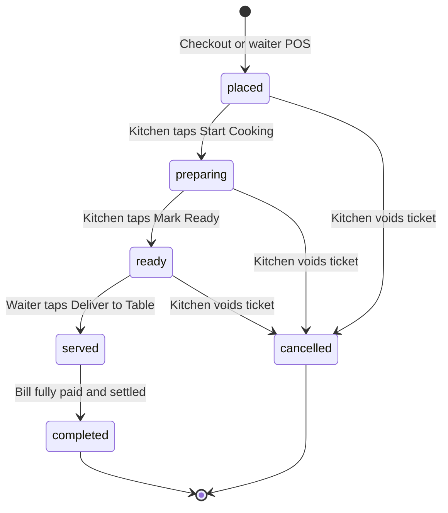

- **Endpoints that drive it:** the kitchen buttons use `PATCH /kitchen/tickets/:id/status` (which also sets the order's status); the waiter uses `PATCH /orders/:id/status`.
- `PATCH /orders/:id/status` validates against this table:

| From | Allowed next |
|---|---|
| `placed` | `accepted`, `cancelled`, `rejected` |
| `accepted` | `preparing`, `cancelled` |
| `preparing` | `ready`, `cancelled` |
| `ready` | `served`, `completed` |
| `served` | `completed` |

- `accepted` and `rejected` exist in the schema/API and the guest stepper shows an "Order Accepted" step, but the **current kitchen UI goes straight from `placed` to `preparing`**.
- When an order becomes `served`, `completed`, `cancelled` or `rejected`, the API calls `settleSessionIfPaid` (see §10.6). Cancelled / rejected orders are also removed from the table bill.
- A deleted order (`DELETE /orders/:id`) is removed from the database entirely; items, modifiers and ticket cascade away, and the table bill is re-synced.

### 8.2 Kitchen ticket status

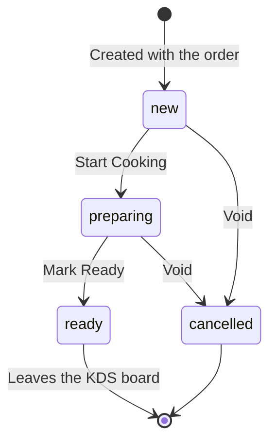

- The API also accepts `acknowledged` (stamps `acknowledged_at`); the KDS UI does not use it. `ready` stamps `ready_at`.
- The KDS lists tickets whose status is **not** `ready` or `cancelled`, oldest first. Cards show table, round, order type, elapsed time (refreshed every 20 s), dishes with portion size and modifiers, and guest notes. Filter tabs: All / New / Cooking.
- A void writes `[VOID] <reason>` into the order notes, sets ticket and order to `cancelled`, and removes the dishes from the bill. The manager's order list shows it as "Void / Cancelled".
- The KDS applies **optimistic UI**: button presses update the screen immediately and the next poll never flips them back.

---

## 9. 🪑 Table sessions & floor lifecycle

A **table session** is one party's visit. A partial unique index guarantees at most one non-closed session per table.

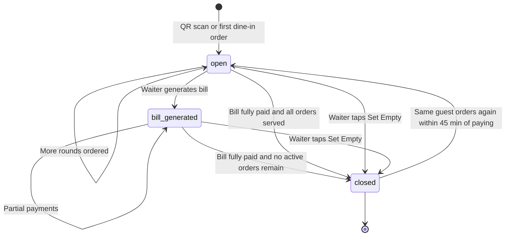

Notes that matter:

- **Session creation.** A session is created when a guest resolves a QR (non-browse mode) or places the first order. Picking a table inside the cart uses *browse mode* (`browse=1`), which is read-only and never creates a session or marks a table occupied.
- **Occupancy is derived from orders.** `GET /tables` (waiter/manager) and `GET /public/tables` report a table as `occupied` when it has any order whose status is not `completed`, `cancelled` or `rejected`; otherwise `available`. The stored `dining_tables.status` is also set to `occupied` when an order is placed and back to `available` when the session closes.
- **Closing after payment (`settleSessionIfPaid`).** When the bill is `paid`: every `served` order placed before settlement becomes `completed`; if no active orders remain, the session closes and the table becomes `available`. Dishes still cooking keep their live status and the guest keeps tracking them; the table frees up after they are served.
- **Set Empty (waiter/manager).** `PATCH /tables/:id/status {status: "available"}` is a deliberate hard reset: it **deletes every non-completed order** of the table (cascading to items and tickets), **deletes unpaid / partially-paid bills**, closes the open session, and resolves pending service requests. *Paid bills and completed orders are preserved.*
- **Table status values** in the schema: `available`, `occupied`, `reserved`, `out_of_service`. Tables set to `out_of_service` are hidden from the guest table picker and their QR is refused (`TABLE_UNAVAILABLE`).
- The session values `bill_requested` and `settled` are valid in the schema and are honoured when looking up live sessions, but the current code does not write them (a guest's "bill" request is recorded as a *service request*; see below).

### Service requests (call waiter)

Guests can send `water`, `cutlery`, `waiter`, `bill`, `cleaning` or `other` from the menu / tracking / running-bill pages (`POST /service-requests/customer`). Requests start `pending`; the waiter's screen polls them, shows an alert state on the floor map, and **Resolve** records who handled it and when.

---

## 10. 💰 Money flow: billing, payments & loyalty

All money is stored as **integer paise** (₹1 = 100 paise) — no floating-point currency. The single source of truth for arithmetic is `billing.utils.ts → computeBillAmounts()`; every code path (waiter, customer, ledger) calls it.

### 10.1 How a bill is computed

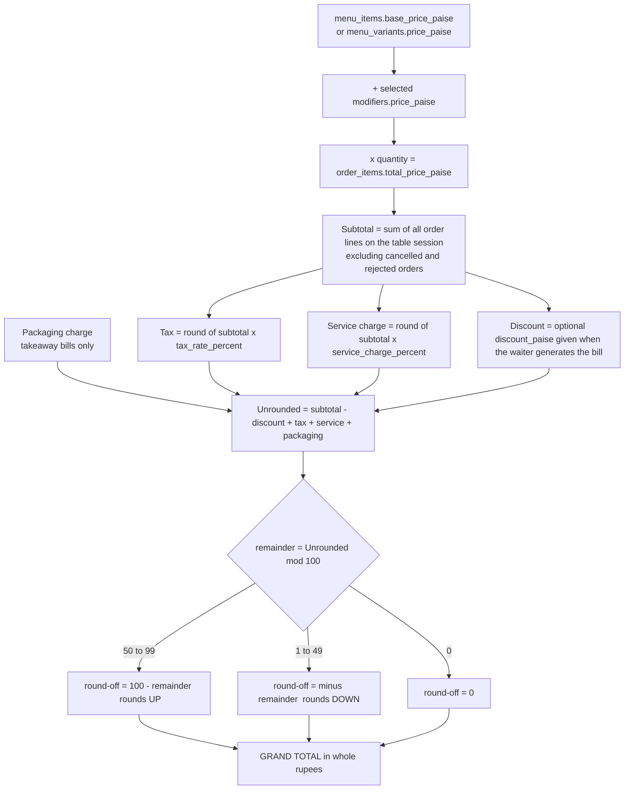

Rules to remember:

- Tax and service charge are computed on the **pre-discount subtotal**.
- Packaging charge applies only to **takeaway** (per-order) bills, not to dine-in session bills.
- Tax rate and service-charge % come from `restaurant_settings` at the moment the bill is (re)computed.

**Worked example** (Royal Spice demo settings: tax 5 %, service charge 2.5 %)

| Line | Paise | Rupees |
|---|---:|---:|
| Old Delhi Butter Chicken – Full Handi | 36,000 | 360.00 |
| Garlic Butter Naan | 6,500 | 65.00 |
| Paneer Tikka Angaare – Regular (6 pcs) | 28,000 | 280.00 |
| **Subtotal** | **70,500** | **705.00** |
| Tax 5 % | 3,525 | 35.25 |
| Service 2.5 % (1,762.5 → rounds to 1,763) | 1,763 | 17.63 |
| Unrounded | 75,788 | 757.88 |
| Round-off (remainder 88 ≥ 50 → +12) | +12 | +0.12 |
| **Grand total** | **75,800** | **₹758.00** |

### 10.2 One bill per table session — the ledger

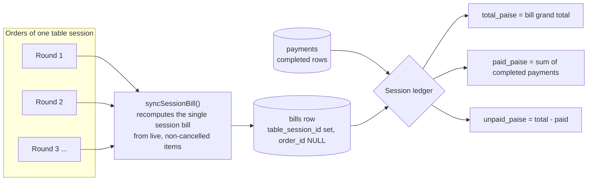

`syncSessionBill()` runs after **every** change to a session's orders: a new order, a void, or a delete. It recomputes the amounts from the live items and re-derives the bill status from the payments already made:

| Condition | Bill status |
|---|---|
| paid ≥ grand total and paid > 0 | `paid` |
| 0 < paid < grand total | `partially_paid` |
| paid = 0 | `unpaid` |

`bills.settled_at` is stamped when a payment completes the bill and is **kept** if the bill later grows. It marks the moment "everything ordered up to here was paid", so any order created after `settled_at` is known to be unpaid (`isOrderPaid`).

**Worked example — ordering again after paying** (same settings):

| Step | Subtotal | Grand total | Paid | Unpaid |
|---|---:|---:|---:|---:|
| Round 1: 2 × Paneer Tikka (₹560.00 subtotal); guest pays in full | ₹560.00 | ₹602.00 | ₹602.00 | **₹0.00** |
| Round 2: +1 Garlic Naan (₹65.00) — same bill re-synced | ₹625.00 | ₹672.00 | ₹602.00 | **₹70.00** |
| Guest / waiter pays the unpaid part only | ₹625.00 | ₹672.00 | ₹672.00 | ₹0.00 |

Nobody is ever charged twice: both payment paths cap the amount at the unpaid balance.

### 10.3 Payment flows

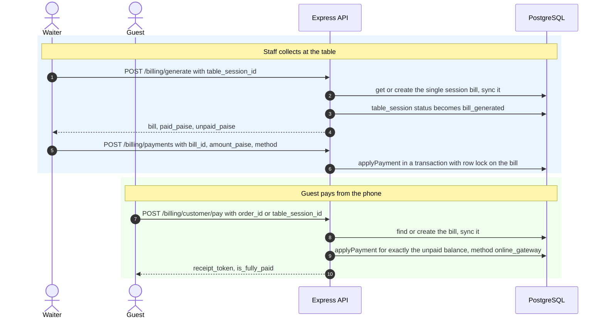

`applyPayment()` (one DB transaction, bill row locked `FOR UPDATE`):

1. Re-syncs the bill so the total includes every order on the table right now.
2. Computes `unpaid = grand_total − completed payments`. If `0` → returns "already paid" (idempotent, no new row).
3. Rejects amounts above `unpaid` (`Amount exceeds the unpaid balance`).
4. Inserts a `payments` row (`status = completed`, `method`, `recorded_by_staff_id`, `transaction_reference`).
5. If `paid ≥ total`: bill → `paid` and `settled_at = now()`; **awards loyalty points**; closes the session via `settleSessionIfPaid` (or, for a takeaway per-order bill, marks the order `completed`).
6. Otherwise: bill → `partially_paid`.

**Payment methods** (`payments.method`): `cash`, `upi_qr`, `upi_manual`, `card`, `online_gateway`. The waiter's settle dialog offers cash, UPI QR and card; the guest pays with `online_gateway`.

> ⚠️ The guest "online payment" is a **simulated gateway**: it records a completed payment immediately with a generated reference (`ONLINE_<timestamp>`). No real payment provider (Razorpay, Stripe, …) is integrated yet. See §19.

### 10.4 Receipts

- Each bill has a `receipt_token_hash`; the raw token is shown/returned only when the bill is created. `GET /billing/public/receipt/:receiptToken` returns restaurant branding, bill, line items, payments and paid / unpaid totals — no login required.
- The **receipt modal** (`ReceiptModal.tsx`) and the guest **Receipt** page use the browser's native `window.print()` with print CSS — no PDF library. It supports an 80 mm thermal-slip layout, a **★ PAID ★** stamp for paid bills, and a transaction reference line.

### 10.5 Loyalty points

Awarded inside `applyPayment` **when a bill becomes fully paid**:

```text
eligible spend  = bill.subtotal − bill.discount           (paise)
target points   = floor(eligible / 100)                   → 1 point per ₹1
new points      = target − points already earned on this bill   (never double-awards)
```

- Points go to the first **non-walk-in** customer found on the bill's session (or order). Walk-in guests earn nothing.
- Each award is a `loyalty_ledger` row (`entry_type = earn`, `points_delta`, `eligible_spend_paise`, `balance_after` = running balance).
- Managers see customers (orders, total spent, balance) and the latest 100 ledger entries in the **Loyalty** tab. **Redemption is not implemented** in this release.
- The settings columns `loyalty_enabled` and `loyalty_earn_ratio` exist and are returned to the UI, but the points formula above is currently fixed at 1 point per ₹1.

### 10.6 Sales analytics (`GET /loyalty/sales`, manager only)

| Metric | Source |
|---|---|
| Paid bill count, net sales (Σ subtotal), tax collected, gross sales (Σ grand total) | `bills` where `status = 'paid'` |
| Revenue by payment method | `payments` (completed) joined to paid bills |
| Top 10 dishes by quantity | `order_items` of non-cancelled / non-rejected orders |
| Daily revenue, last 7 days | paid bills grouped by `settled_at` day |

DevAdmin's platform overview uses the same principle: platform volume = Σ `grand_total_paise` of paid bills.

---

## 11. 🖥️ Screens & how each role uses them

### 11.1 Route map (`App.tsx`)

| Route | Screen | Access |
|---|---|---|
| `/` | Portal hub: launcher cards per restaurant (bare host) or direct links (subdomain) | Public |
| `/u/customer/table?t=<token>` | QR landing → resolves table + session | Guest |
| `/u/customer/menu` | Menu with categories, dietary badges, sold-out state, call-waiter shortcut, bill shortcut | Guest |
| `/u/customer/cart` | Cart, Dine-in / Takeaway toggle, **manual table picker**, price preview | Guest |
| `/u/customer/checkout` | Mobile number (required), name, kitchen notes → place order | Guest |
| `/u/customer/order/:orderId?token=` | **Live tracking** | Guest (token) |
| `/u/customer/bill` | **Running bill** of the table session + pay online | Guest |
| `/u/customer/receipt/:receiptToken` | Public tax receipt (printable) | Guest (token) |
| `/s/login` | Staff login (tenant-scoped) | Staff |
| `/s/kitchen/dashboard` | Kitchen Display System | Kitchen, Manager |
| `/s/waiter/dashboard` (alias `/s/waiter/tables`) | Floor map & POS | Waiter, Manager |
| `/s/manager/*` | Manager console | Manager |
| `/d/devadmin` | Platform owner portal | DevAdmin |

### 11.2 Customer experience

- **Order tracking** shows a 5-step stepper per order — *Placed → Accepted → Preparing → Ready → Served* — and each round tracks its **own** kitchen progress independently. With 2+ orders on the table the list becomes collapsible accordions (collapsed by default); with one order it opens directly. Each order has its own receipt button.
- The page shows the shared ledger (total / paid / unpaid), a **Call Waiter** action, and **Pay online** for the unpaid part.
- The cart shows an *estimate* (subtotal + tax + packaging for takeaway). The authoritative total — including service charge and round-off — is computed by the server when the bill is created.
- The cart is kept in `sessionStorage`, so a refresh does not lose it.

### 11.3 Kitchen (KDS)

New tickets appear as cards; **Start Cooking** then **Mark Ready**; **Void** (with confirmation). A Web-Audio chime (synthesised in the browser, no audio files) plays when the ticket count increases; sound can be toggled. Tickets carry no money data.

### 11.4 Waiter floor

- **Floor map** (`FloorMap.tsx`): SVG tables with visual states — free, busy, and an alert state when a service request is pending; a green badge when dishes are ready.
- **Ready to Serve** queue: orders in `ready` state with the dishes to deliver → **Deliver** marks them `served`.
- **Table drawer**: orders by round with status and per-order receipt, the live session ledger (total / paid / unpaid), delete-order, **Set Empty**, **Place Order (POS)** and **Settle Bill**.
- **Settle Bill**: generates/syncs the table bill and records one payment for exactly the unpaid amount using cash, UPI QR or card.
- Optimistic UI is used for *served*, *resolve request* and *set empty*, so the screen reacts instantly and reconciles on the next poll.

### 11.5 Manager console (tabs)

| Tab | Features |
|---|---|
| **Overview** | Gross sales, tax collected, paid bills, occupied/total tables, 10 most recent orders with receipt button and void markers |
| **Menu** | Add category, add dish (price, dietary type `veg / non_veg / egg / vegan`, prep time, photo upload, portion variants, modifier groups with min/max/required), sold-out toggle, delete dish (category delete is available via API) |
| **Tables** | Add table + capacity, generate/rotate QR and **print** it from the QR dialog |
| **Sales** | Totals, payment-method split, top dishes, 7-day trend |
| **Staff** | List staff and create manager/waiter/kitchen accounts (activate/deactivate is available via API) |
| **Loyalty** | Customer list with order count, spend and points balance; points ledger |

### 11.6 DevAdmin portal

Login against `DEVADMIN_EMAIL` / `DEVADMIN_PASSWORD` (server-side check) → platform overview (restaurants total/active/suspended, platform orders, paid volume, last 25 audit entries), restaurant list with staff/table/order counts and revenue, **create restaurant** (tenant + default settings + first manager, in one transaction), **suspend / reactivate**, **delete** (soft: `status = 'deleted'`). Create and status changes are written to `audit_logs`.

### Polling intervals

The app uses **HTTP polling** — there are no websockets or database push channels in the feature code.

| Screen | Interval | Endpoint(s) |
|---|---:|---|
| Kitchen KDS | 3.5 s | `GET /kitchen/tickets` |
| Waiter floor | 4 s | `GET /tables`, `GET /orders/staff/list`, `GET /service-requests/waiter` |
| Guest order tracking | 4 s | `GET /orders/customer/:id` |
| Guest running bill | 4 s | `GET /billing/session/:sessionId` |

---

## 12. 🗄️ Database design

Source of truth: [`supabase/migrations/20261109000001_initial_schema.sql`](supabase/migrations/20261109000001_initial_schema.sql). IDs are `UUID` (`uuid-ossp`), money columns are `INTEGER` paise, timestamps are `TIMESTAMPTZ`. Child tables of a restaurant use `ON DELETE CASCADE`.

### 12.1 Entity-relationship diagram

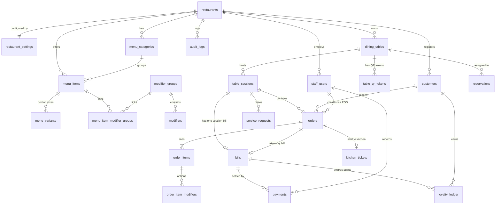

### 12.2 Table reference (all 23 tables)

**Tenancy & access**

| Table | Purpose / key columns | Constraints |
|---|---|---|
| `restaurants` | Tenant: `name`, `slug`, `primary_domain`, `logo_url`, `favicon_url`, `primary_color` (`#e11d48`), `secondary_color` (`#1e293b`), `currency` (`INR`), `timezone` (`Asia/Kolkata`), `status` | `slug` & `primary_domain` UNIQUE; `status ∈ active, suspended, deleted` |
| `restaurant_settings` | PK = `restaurant_id`: `tax_rate_percent` (5.00), `service_charge_percent` (0.00), `packaging_charge_paise` (0), `dine_in_enabled`, `takeaway_enabled`, `auto_accept_orders`, `loyalty_enabled`, `loyalty_earn_ratio` | 1-to-1 with restaurant |
| `staff_users` | `email`, `password_hash` (bcrypt), `full_name`, `role`, `is_active` | UNIQUE(`restaurant_id`,`email`); `role ∈ manager, waiter, kitchen` |
| `audit_logs` | `actor_type`, `actor_id`, `action`, `details` JSONB, `ip_address` | `actor_type ∈ devadmin, staff, system, customer` |

**Menu**

| Table | Purpose / key columns | Constraints |
|---|---|---|
| `menu_categories` | `name`, `description`, `sort_order`, `is_active` | – |
| `menu_items` | `category_id`, `name`, `description`, `base_price_paise`, `image_url`, `dietary_type`, `preparation_time_minutes` (15), `is_available`, `sort_order` | price ≥ 0; `dietary_type ∈ veg, non_veg, egg, vegan` |
| `menu_variants` | Portion options: `menu_item_id`, `name`, `price_paise` (absolute price), `is_available` | price ≥ 0 |
| `modifier_groups` | `name`, `min_selection`, `max_selection`, `is_required` | – |
| `modifiers` | `modifier_group_id`, `name`, `price_paise` (upcharge), `is_available` | price ≥ 0 |
| `menu_item_modifier_groups` | Join dish ↔ group | PK(`menu_item_id`,`modifier_group_id`) |

**Floor**

| Table | Purpose / key columns | Constraints |
|---|---|---|
| `dining_tables` | `table_number`, `capacity` (4), `status`, `is_active` | UNIQUE(`restaurant_id`,`table_number`); `status ∈ available, occupied, reserved, out_of_service` |
| `table_qr_tokens` | `table_id`, `token_hash` (SHA-256), `is_revoked`, `generated_at` | `token_hash` UNIQUE |
| `table_sessions` | `table_id`, `status`, `opened_at`, `closed_at` | `status ∈ open, bill_requested, bill_generated, settled, closed`; **partial UNIQUE index**: one non-closed session per (`restaurant_id`,`table_id`) |
| `reservations` | `table_id`, `customer_name`, `customer_phone`, `party_size`, `reservation_time`, `notes`, `status` | schema-ready; no API/UI yet |
| `service_requests` | `table_session_id`, `table_id`, `request_type`, `notes`, `status`, `resolved_by_staff_id`, `resolved_at` | `request_type ∈ water, cutlery, waiter, bill, cleaning, other`; `status ∈ pending, in_progress, resolved` |

**Orders & kitchen**

| Table | Purpose / key columns | Constraints |
|---|---|---|
| `customers` | `phone_e164`, `name` | UNIQUE(`restaurant_id`,`phone_e164`) |
| `orders` | `order_number`, `order_type`, `table_session_id`, `table_id`, `customer_id`, `customer_phone_snapshot`, `status`, `access_token_hash`, `subtotal_paise`, `notes`, `created_by_staff_id` | `order_type ∈ dine_in, takeaway`; `status ∈ placed, accepted, preparing, ready, served, completed, cancelled, rejected`; `access_token_hash` UNIQUE |
| `order_items` | **Snapshots**: `name_snapshot`, `variant_name_snapshot`, `unit_price_paise`, `quantity`, `total_price_paise`; nullable links to the live dish/variant (`SET NULL`) | `quantity > 0` |
| `order_item_modifiers` | `name_snapshot`, `unit_price_paise` | – |
| `kitchen_tickets` | `order_id`, `ticket_number` (`K-101`), `status`, `acknowledged_at`, `ready_at` | `status ∈ new, acknowledged, preparing, ready, cancelled` |

**Money**

| Table | Purpose / key columns | Constraints |
|---|---|---|
| `bills` | `bill_number` (`INV-<year>-<1001…>`), `table_session_id` *or* `order_id`, `subtotal_paise`, `discount_paise`, `tax_paise`, `service_charge_paise`, `packaging_charge_paise`, `round_off_paise`, `grand_total_paise`, `status`, `receipt_token_hash`, `settled_at` | `status ∈ unpaid, partially_paid, paid, voided`; `receipt_token_hash` UNIQUE. Dine-in session bill: `order_id` NULL. Takeaway bill: `table_session_id` NULL |
| `payments` | `bill_id`, `amount_paise`, `method`, `status`, `recorded_by_staff_id`, `transaction_reference` | `amount_paise > 0`; `method ∈ cash, upi_qr, upi_manual, card, online_gateway`; `status ∈ pending, completed, failed, refunded` |
| `loyalty_ledger` | `customer_id`, `points_delta`, `entry_type`, `source_bill_id`, `eligible_spend_paise`, `balance_after` | `entry_type ∈ earn, refund_reversal, adjustment` (only `earn` is written today) |

**Performance indexes** exist on restaurant slug/domain, staff (restaurant, role), menu categories/items, tables, QR token hash, sessions, orders (restaurant, status, created_at desc), kitchen tickets, service requests, bills, payments and loyalty.

### 12.3 Restaurant settings — what is enforced today

| Setting | Effect in current code |
|---|---|
| `tax_rate_percent` | ✅ Used in every bill calculation |
| `service_charge_percent` | ✅ Used in every bill calculation |
| `packaging_charge_paise` | ✅ Added to **takeaway** bills |
| `dine_in_enabled`, `takeaway_enabled` | Stored and returned to the UI; **not yet enforced** |
| `auto_accept_orders` | Stored; **not yet used** (orders always start as `placed`) |
| `loyalty_enabled`, `loyalty_earn_ratio` | Stored and returned; points currently fixed at 1 per ₹1 |

---

## 13. 🪣 File storage

Dish photos are uploaded by managers through the API (`POST /menu/items/upload-image`), which writes to the **public** Supabase Storage bucket **`menu-items`** using the server's service-role key.

| Rule | Value |
|---|---|
| Accepted types | JPEG, PNG, WEBP, GIF |
| Max size | 5 MB (checked in the API after base64 decode) |
| Path | `<restaurant slug or id>/<timestamp>_<safe-name>_<random-hex>.<ext>` |
| Result | Public URL saved into `menu_items.image_url` |

You must **create the bucket yourself** (the code does not):

```sql
INSERT INTO storage.buckets (id, name, public)
VALUES ('menu-items', 'menu-items', true)
ON CONFLICT (id) DO NOTHING;

-- Public read so guests' browsers can load the images
CREATE POLICY "Public Read Menu Items"
ON storage.objects FOR SELECT
USING (bucket_id = 'menu-items');
```

Writes come from the backend using the **service-role key**, which bypasses Row-Level Security, so no insert/update policies are required. Keep that key server-side only.

---

## 14. 📡 API reference

Base URL: `/api/v1` (plus `GET /api/health`). Every route except DevAdmin is tenant-scoped (§5.1). Errors are JSON: `{ "error": "CODE", "message": "…" }`.

**Legend:** 🌐 public · 🎫 public with secret token · 👨‍🍳 kitchen · 🛎️ waiter · 👔 manager · 🛡️ DevAdmin

### Auth
| Method | Path | Access | Description |
|---|---|:--:|---|
| POST | `/auth/login` | 🌐 | Staff login → JWT + user |
| GET | `/auth/me` | any staff | Current staff profile |

### Public (guest)
| Method | Path | Access | Description |
|---|---|:--:|---|
| GET | `/public/restaurant` | 🌐 | Branding + settings (tax, service, packaging, flags) |
| GET | `/public/tables` | 🌐 | Active tables with derived `available/occupied` status |
| GET | `/public/qr/resolve?t=<token>[&resto=<slug>][&browse=1]` | 🌐 | Resolve QR (or table number) → restaurant, table, session. `browse=1` = read-only |
| GET | `/menu/public` | 🌐 | Active categories → dishes → variants → modifier groups → modifiers |

### Orders
| Method | Path | Access | Description |
|---|---|:--:|---|
| POST | `/orders/customer/checkout` | 🌐 | Place an order (`order_type`, `table_id`, `table_session_id`, `phone`, `customer_name`, `notes`, `items[]`) |
| POST | `/orders/waiter/order` | 🛎️👔 | Place an order for a guest (phone optional) |
| GET | `/orders/customer/:id?token=` | 🎫 | Live tracking + whole-session ledger |
| GET | `/orders/staff/list[?status=]` | 🛎️👔 | Latest 100 orders with round, items, `bill_status`, `is_paid` |
| PATCH | `/orders/:id/status` | 👨‍🍳🛎️👔 | State-machine transition (§8.1) |
| DELETE | `/orders/:id` | 🛎️👔 | Hard-delete order, re-sync bill, free table if empty |

### Kitchen
| Method | Path | Access | Description |
|---|---|:--:|---|
| GET | `/kitchen/tickets` | 👨‍🍳🛎️👔 | Active tickets (not ready / cancelled), oldest first |
| PATCH | `/kitchen/tickets/:id/status` | 👨‍🍳🛎️👔 | `acknowledged` / `preparing` / `ready` |
| DELETE | `/kitchen/tickets/:id` | 👨‍🍳👔 | Void ticket + order (soft), body `{reason}` |

### Tables & floor
| Method | Path | Access | Description |
|---|---|:--:|---|
| GET | `/tables` | 🛎️👔 | Floor list with derived status, `active_session_id`, `session_status` |
| POST | `/tables` | 👔 | Create table (+ initial QR token) |
| POST | `/tables/:id/qr` | 👔 | Rotate QR token (revokes old ones) → `raw_token`, `qr_url`, `qr_image` (PNG data-URL) |
| PATCH | `/tables/:id/status` | 🛎️👔 | Set status; `available` performs the **Set Empty** reset (§9) |
| POST | `/service-requests/customer` | 🌐 | Guest call (`water, cutlery, waiter, bill, cleaning, other`) |
| GET | `/service-requests/waiter` | 🛎️👔 | Pending requests |
| PATCH | `/service-requests/waiter/:id/resolve` | 🛎️👔 | Mark resolved |

### Billing
| Method | Path | Access | Description |
|---|---|:--:|---|
| GET | `/billing/session/:sessionId` | 🌐 (by session id) | Ledger: orders, items, tax/service/round-off, `total / paid / unpaid` |
| POST | `/billing/generate` | 🛎️👔 | Create / re-sync the table bill (`table_session_id`) or a single-order bill (`order_id`); optional `discount_paise` |
| POST | `/billing/payments` | 🛎️👔 | Record payment (`bill_id`, `amount_paise`, `method`, `transaction_reference`) |
| POST | `/billing/customer/pay` | 🌐 | Guest pays the unpaid balance (`order_id` or `table_session_id`) |
| GET | `/billing/public/receipt/:receiptToken` | 🎫 | Public receipt |

### Manager
| Method | Path | Access | Description |
|---|---|:--:|---|
| POST / DELETE | `/menu/categories`, `/menu/categories/:id` | 👔 | Create / delete category |
| POST | `/menu/items` | 👔 | Create dish with variants and modifier groups (single transaction) |
| PATCH | `/menu/items/:id/availability` | 👔 | Sold-out toggle |
| DELETE | `/menu/items/:id` | 👔 | Delete dish |
| POST | `/menu/items/upload-image` | 👔 | Upload photo (base64) → public URL |
| GET | `/loyalty/sales` | 👔 | Sales analytics (§10.6) |
| GET | `/loyalty/customers` | 👔 | Customers with orders, spend, points |
| GET | `/loyalty/ledger` | 👔 | Latest 100 points entries |
| GET / POST | `/manager/staff` | 👔 | List / create staff |
| PATCH | `/manager/staff/:id/status` | 👔 | Activate / deactivate |

### DevAdmin (not tenant-scoped, Bearer DevAdmin JWT)
| Method | Path | Description |
|---|---|---|
| POST | `/devadmin/auth/login` | Login (env credentials) |
| GET | `/devadmin/auth/me` | Session check |
| GET | `/devadmin/overview` | Platform stats + last 25 audit logs |
| GET | `/devadmin/restaurants` | All tenants with staff/table/order counts and revenue |
| POST | `/devadmin/restaurants` | Create tenant + default settings + manager account |
| PATCH | `/devadmin/restaurants/:id/status` | `active` / `suspended` / `deleted` |
| DELETE | `/devadmin/restaurants/:id` | Soft-delete |

---

## 15. 🚀 Getting started (local)

### Prerequisites

- **Node.js 20+** and **npm 10+**
- A **Supabase** project (or any PostgreSQL 14+ you can reach over SSL — the pool is configured for SSL)

### Step 1 — Install

```bash
git clone <your-repository-url>
cd <repository-folder>
npm install            # installs both workspaces
```

### Step 2 — Create the schema

In the Supabase dashboard → **SQL Editor**, paste and run the whole of
`supabase/migrations/20261109000001_initial_schema.sql` (creates all 23 tables, constraints and indexes).

### Step 3 — Create the storage bucket

Run the SQL in [§13](#13--file-storage).

### Step 4 — Configure the environment

Create a file named `.env` in the **repository root** (it is git-ignored; the API also looks in `apps/api` and its parent):

```env
# ── Server ──────────────────────────────────────────────
PORT=5000
NODE_ENV=development

# ── Supabase (Project Settings → API) ───────────────────
SUPABASE_URL=https://<project-id>.supabase.co
SUPABASE_ANON_KEY=<anon-key>
SUPABASE_SERVICE_ROLE_KEY=<service-role-key>      # server only, never expose

# ── Postgres (Project Settings → Database → Connection string → URI)
DATABASE_URL=postgresql://postgres:<password>@db.<project-id>.supabase.co:5432/postgres

# ── Secrets: use long random strings in production ──────
SESSION_SECRET=<64+ random characters>            # signs all JWTs

# ── Platform owner (DevAdmin) ───────────────────────────
DEVADMIN_EMAIL=<your-admin-email>
DEVADMIN_PASSWORD=<strong-password>
```

| Variable | Used for |
|---|---|
| `PORT` | API port (default `5000`) |
| `NODE_ENV` | `development` / `production` |
| `SUPABASE_URL`, `SUPABASE_SERVICE_ROLE_KEY` (falls back to `SUPABASE_ANON_KEY`) | Storage client |
| `DATABASE_URL` | PostgreSQL pool |
| `SESSION_SECRET` | JWT signing (staff + DevAdmin) |
| `DEVADMIN_EMAIL`, `DEVADMIN_PASSWORD` | DevAdmin login |

> `CLIENT_URL`, `QR_TOKEN_SECRET` and `DEFAULT_COUNTRY_CODE` are read by `env.ts` but are not used by current features (the default country code `+91` is hard-coded in order handling).
>
> **If you do not set `SESSION_SECRET`, `DEVADMIN_EMAIL` or `DEVADMIN_PASSWORD`, the code falls back to public development defaults.** Always set your own before exposing the app.

### Step 5 — Seed demo data

```bash
npm run seed --workspace=apps/api          # tenants, staff, base menu, tables T-01..T-05
npx tsx apps/api/src/db/seed_more.ts       # more dishes, tables T-06..T-10, Urban Crust menu/tables/staff
```

### Step 6 — Run

```bash
npm run dev           # API on :5000 and website on :5173, together
```

| Script (root) | What it does |
|---|---|
| `npm run dev` | API (`tsx watch`) + website (Vite) concurrently |
| `npm run dev:api` / `npm run dev:website` | Either one alone |
| `npm run build` | `tsc` for the API → `apps/api/dist`; `tsc && vite build` → `apps/website/dist` |
| `npm test` | API integration tests |

Open **`http://royalspice.localhost:5173`** (Royal Spice) or **`http://urbancrust.localhost:5173`**, or `http://localhost:5173` for the portal hub.

---

## 16. 🌍 Production deployment

1. Provision Node 20+, build with `npm run build`, and start the API: `node apps/api/dist/index.js` (set `NODE_ENV=production`).
2. Serve `apps/website/dist` as a static SPA (every path falls back to `index.html`).
3. Put Nginx (or any reverse proxy) in front. It **must forward the original host** so tenant resolution works:

```nginx
server {
    listen 80;
    server_name smartresto.example.com *.smartresto.example.com;   # add TLS (certbot) for production

    location / {
        root /var/www/smartresto/apps/website/dist;
        try_files $uri $uri/ /index.html;
    }

    location /api/ {
        proxy_pass http://127.0.0.1:5000;
        proxy_http_version 1.1;
        proxy_set_header Host              $host;
        proxy_set_header X-Forwarded-Host  $host;
        proxy_set_header X-Real-IP         $remote_addr;
        proxy_set_header X-Forwarded-For   $proxy_add_x_forwarded_for;
        proxy_set_header X-Forwarded-Proto $scheme;
    }
}
```

4. In DevAdmin, create each restaurant with `primary_domain` = its real domain (e.g. `menu.royalspice.com`) **or** a subdomain whose first label equals its `slug`.
5. **Process manager (example with PM2):**

```bash
npm install -g pm2
pm2 start apps/api/dist/index.js --name smartresto-api
pm2 save && pm2 startup
```

6. **Database connections:** with several API instances, use Supabase's pooled connection string in `DATABASE_URL`.
7. **Phone testing without a domain:** `cloudflared tunnel --url http://localhost:5173` gives a public HTTPS URL; open it with `?resto=<slug>` once so the tenant is remembered.

Run through the checklist in [§19](#19--known-limitations--production-hardening-checklist) before going live.

---

## 17. 🔑 Demo data & credentials

> These come from the seed scripts and are for **local demos only** — change or delete them in production.

**Platform owner (DevAdmin)** — `http://localhost:5173/d/devadmin`
Credentials are whatever you set in `.env` (`DEVADMIN_EMAIL` / `DEVADMIN_PASSWORD`).

**Restaurant 1 — Royal Spice Bistro** (`royalspice`, tax 5 %, service 2.5 %, takeaway packaging ₹25)

| Role | Email | Password |
|---|---|---|
| Manager | `manager@royalspice.com` | `Manager@123` |
| Waiter | `waiter@royalspice.com` | `Waiter@123` |
| Kitchen | `kitchen@royalspice.com` | `Kitchen@123` |

- Tables `T-01` … `T-10`; demo QR token for T-01: `demo_token_table_1_royalspice`
- Guest QR link: `http://royalspice.localhost:5173/u/customer/table?t=demo_token_table_1_royalspice` (shortcut: `?t=1`)
- Staff login: `http://royalspice.localhost:5173/s/login`

**Restaurant 2 — Urban Crust Pizzeria** (`urbancrust`, tax 5 %, no service charge, takeaway packaging ₹30)

| Role | Email | Password |
|---|---|---|
| Manager | `manager@urbancrust.com` | `Manager@123` |
| Waiter | `waiter@urbancrust.com` | `Waiter@123` |
| Kitchen | `kitchen@urbancrust.com` | `Waiter@123` |

- Tables `T-01` … `T-06`; demo QR token for T-01: `demo_token_table_1_urbancrust`
- Guest QR link: `http://urbancrust.localhost:5173/u/customer/table?t=demo_token_table_1_urbancrust`

**Try the whole flow in 2 minutes**

1. Open three tabs: guest QR link, `/s/login` as **kitchen**, `/s/login` as **waiter** (staff tokens are per-tab).
2. Guest: add dishes → Checkout (any 10-digit number) → watch the tracking page.
3. Kitchen: **Start Cooking** → **Mark Ready**.
4. Waiter: the dish appears under **Ready to Serve** → **Deliver**; open the table → **Settle Bill** (cash).
5. Guest page flips to paid; the table returns to available; the manager's **Loyalty** tab shows the points.

---

## 18. 🧪 Testing

```bash
npm test
```

`apps/api/src/test/integration.test.ts` starts the real Express app on port **5001** and exercises it over HTTP **against your configured database** — seed it first (§15, Step 5). The suite walks nine phases:

1. DevAdmin login and platform overview
2. Tenant resolution and branding (Royal Spice)
3. QR token resolution and table-session creation
4. Menu retrieval (variants, dietary type, prep time, price)
5. Customer checkout with server-side price recalculation
6. Order-tracking token security (401 without token, 200 with)
7. Kitchen login and ticket lifecycle `new → preparing → ready`
8. Waiter bill generation, cash payment, and loyalty-point accrual
9. DevAdmin suspend → tenant gets `403 RESTAURANT_SUSPENDED` while the other tenant stays up → reactivate

> The suite creates real orders and temporarily suspends then restores Royal Spice. Do not run it against a live production database.

---

## 19. ⚠️ Known limitations & production-hardening checklist

Being explicit here so there are no surprises:

**Before going live**

- [ ] Set strong, unique `SESSION_SECRET`, `DEVADMIN_EMAIL`, `DEVADMIN_PASSWORD` (the code has public fallbacks for local development).
- [ ] Change/delete all seeded demo accounts and the `demo_token_table_1_*` QR tokens.
- [ ] Serve everything over HTTPS; restrict CORS (currently `origin: true`, i.e. reflective, with credentials).
- [ ] Add rate limiting / brute-force protection on login and public endpoints.
- [ ] Integrate a real payment provider — today `online_gateway` just records a completed payment.
- [ ] Decide on access hardening for `GET /billing/session/:sessionId` (public, protected only by the session's unguessable UUID) and consider moving guest session identity to a token like orders/receipts use.
- [ ] Consider enabling Postgres Row-Level Security as defence in depth (isolation today is enforced in application code via `restaurant_id` in every query).

**Functional gaps (by design in this release)**

- Updates are **polling-based** (3.5–4 s), not push.
- `reservations` table exists but has no API/UI.
- Loyalty **redemption** is not implemented; points rate is fixed at 1 per ₹1.
- `dine_in_enabled`, `takeaway_enabled`, `auto_accept_orders` are stored but not enforced.
- The kitchen UI skips the `accepted` step; `rejected` and `acknowledged` are API-only.
- Modifier `min/max/required` rules are stored and shown but not validated server-side at checkout.
- The per-order receipt preview in the waiter drawer uses a fixed 5 % tax estimate; the table bill and the session receipt use the real configured rates.
- Order and invoice numbers are derived from counts (daily order count; total bills count), which is fine for a single API instance but could collide under heavy concurrency.
- The manual `Set Empty` is destructive by design (deletes active orders and unpaid bills of the table).

---

## 20. 🛠️ Troubleshooting & FAQ

**The app shows "Service suspended" on one restaurant only.**
DevAdmin suspended that tenant. Reactivate it in `/d/devadmin`. Other restaurants are unaffected.

**Staff login says "TENANT_MISMATCH" or I get logged out.**
The JWT was issued for a different restaurant. Log in again on the right restaurant's domain (or with `?resto=<slug>`).

**The API returns the wrong restaurant on a tunnel / IP address.**
Tunnels and bare IPs cannot carry the slug in the host. Open the site once with `?resto=<slug>` (the SPA then sends `x-restaurant-slug`), or use real subdomains.

**QR images I generate in the Manager console don't open locally.**
`POST /tables/:id/qr` builds the link from `restaurants.primary_domain`: if it contains no `:` it uses `https://`. Seeded domains (`royalspice.localhost`) have no port, so the generated link is `https://royalspice.localhost/…`. For local testing use the demo links in §17 (or `?t=1`); in production set `primary_domain` to your real HTTPS domain.

**"Table 1" vs "Table 10" — can they collide?**
No. When a QR value is not an opaque token, the API matches the table by exact number using integer comparison of the digits (`regexp_replace(table_number,'[^0-9]','','g')::integer`), so `1` and `10` are distinct.

**Image upload fails.**
Check that the `menu-items` bucket exists and is public, `SUPABASE_SERVICE_ROLE_KEY` is set, the image is JPEG/PNG/WEBP/GIF and ≤ 5 MB.

**Guest paid but the table still shows occupied.**
By design the session closes only when the bill is paid **and** no active orders remain. If a dish is still cooking, the table frees up once it is served (the waiter taps *Deliver*), or the waiter can use *Set Empty*.

**Guest paid, then ordered another dish.**
Within 45 minutes the closed session is re-opened on the same bill; the total grows, the paid amount stays, and only the new dish is unpaid (§10.2).

**A voided or deleted order disappeared from the bill.**
Correct — cancelled/rejected/deleted orders are excluded from the subtotal and the bill is re-synced immediately.

**`npm test` fails to connect.**
The tests use your real database; verify `DATABASE_URL`, run the migration, and seed first.

---

## 📄 License & attribution

Designed for multi-tenant hospitality operations. Built with TypeScript, React, Vite, Express and Supabase PostgreSQL. Add your own `LICENSE` file before distributing.
