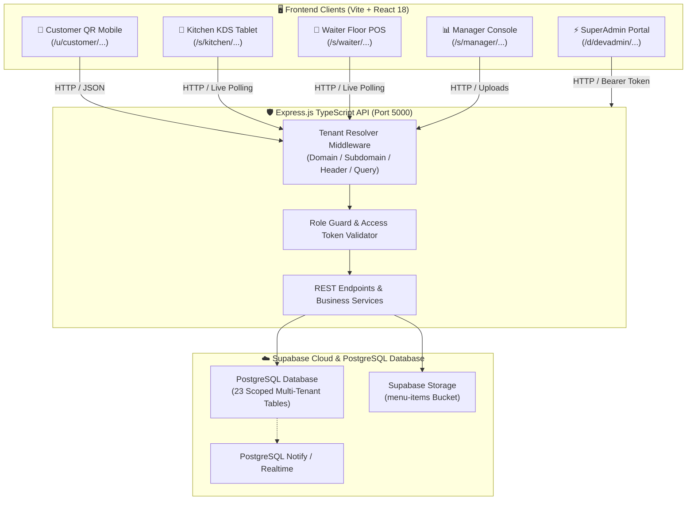
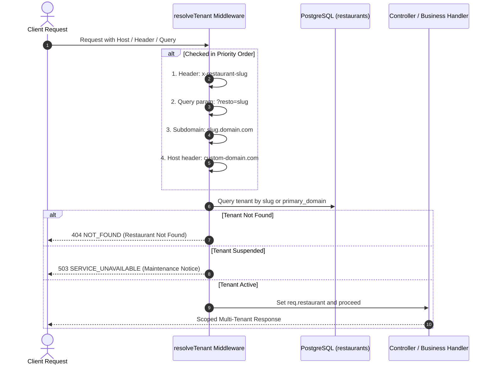
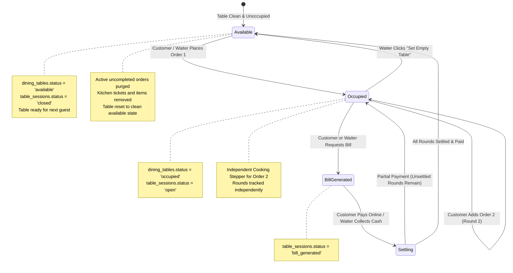
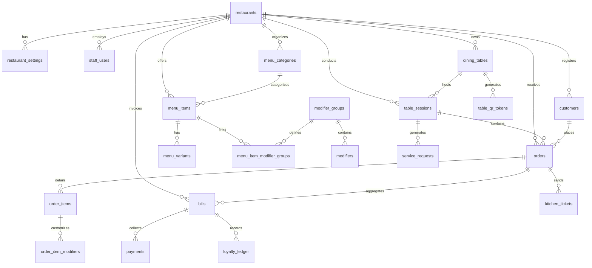
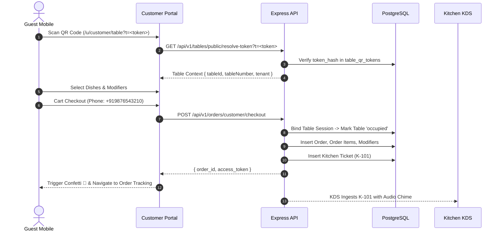

# 🍽️ Smart Restaurant Operations & QR Ordering SaaS Platform

[](https://nodejs.org/)
[](https://www.typescriptlang.org/)
[](https://expressjs.com/)
[](https://react.dev/)
[](https://vitejs.dev/)
[](https://tailwindcss.com/)
[](https://supabase.com/)

> A production-ready, enterprise-grade, multi-tenant restaurant operations platform and contactless QR ordering system. Features real-time Kitchen Display System (KDS), Waiter Floor Captain POS, Manager Dashboard with Dynamic Recipe Builder, Platform SuperAdmin (DevAdmin), automated table occupancy lifecycles, independent multi-round dining progress tracking, and browser-side thermal receipt printing with zero external dependencies.

---

## 📑 Table of Contents

- [🌟 System Architecture & Interactive Flow](#-system-architecture--interactive-flow)
  - [High-Level Data Flow](#high-level-data-flow)
  - [Tenant Resolution Lifecycle](#tenant-resolution-lifecycle)
  - [Dining Table Occupancy & Multi-Round Lifecycle](#dining-table-occupancy--multi-round-lifecycle)
- [🗄️ Supabase Database Architecture & Schema](#️-supabase-database-architecture--schema)
  - [Entity-Relationship Diagram (ERD)](#entity-relationship-diagram-erd)
  - [Complete 23-Table Data Dictionary](#complete-23-table-data-dictionary)
- [🪣 Supabase Storage Buckets Structure](#-supabase-storage-buckets-structure)
  - [Bucket Specification](#bucket-specification)
  - [Folder Hierarchy & Naming Convention](#folder-hierarchy--naming-convention)
  - [Row-Level Security (RLS) Policies](#row-level-security-rls-policies)
- [🔄 How Everything Works Step-by-Step](#-how-everything-works-step-by-step)
  - [1. Contactless Customer QR Journey](#1-contactless-customer-qr-journey)
  - [2. Multi-Round Dining & Accordion Tracking UX](#2-multi-round-dining--accordion-tracking-ux)
  - [3. Browser-Side Thermal Receipt Maker](#3-browser-side-thermal-receipt-maker)
  - [4. Kitchen Display System (KDS) Live Lifecycle](#4-kitchen-display-system-kds-live-lifecycle)
  - [5. Waiter Floor Captain Operations & Table Management](#5-waiter-floor-captain-operations--table-management)
  - [6. Manager Console & Recipe Builder](#6-manager-console--recipe-builder)
  - [7. Platform SuperAdmin (DevAdmin) Multi-Tenancy Engine](#7-platform-superadmin-devadmin-multi-tenancy-engine)
- [🚀 Drop-in Deployment Guide (Running On Another Platform)](#-drop-in-deployment-guide-running-on-another-platform)
  - [Prerequisites](#prerequisites)
  - [Step 1: Clone Repository & Install Dependencies](#step-1-clone-repository--install-dependencies)
  - [Step 2: Database Migration & Schema Creation](#step-2-database-migration--schema-creation)
  - [Step 3: Storage Bucket Setup](#step-3-storage-bucket-setup)
  - [Step 4: Environment Variables Configuration](#step-4-environment-variables-configuration)
  - [Step 5: Database Seeding (Demo Restaurants & Rich Data)](#step-5-database-seeding-demo-restaurants--rich-data)
  - [Step 6: Build the Full Workspace](#step-6-build-the-full-workspace)
  - [Step 7: Launch Development Environment](#step-7-launch-development-environment)
  - [Step 8: Production Deployment (Docker / PM2 / VPS)](#step-8-production-deployment-docker--pm2--vps)
  - [Step 9: Mobile Tunneling & Public Testing (Cloudflare)](#step-9-mobile-tunneling--public-testing-cloudflare)
  - [Step 10: Automated Integration Tests](#step-10-automated-integration-tests)
- [🔑 Default Credentials & Quick Links](#-default-credentials--quick-links)
- [📡 API Endpoints Catalog](#-api-endpoints-catalog)
- [🛠️ Troubleshooting & FAQ](#️-troubleshooting--faq)

---

## 🌟 System Architecture & Interactive Flow

### High-Level Data Flow



---

### Tenant Resolution Lifecycle

Every single request (except global superadmin routes) passes through the `resolveTenant` middleware in [`tenant.middleware.ts`](file:///home/harshvardhan/Restorants/QR-ODERING/apps/api/src/middleware/tenant.middleware.ts):



---

### Dining Table Occupancy & Multi-Round Lifecycle



---

## 🗄️ Supabase Database Architecture & Schema

The platform runs on PostgreSQL with standard relational foreign-key cascades, check constraints, and composite indexes designed for scale.

### Entity-Relationship Diagram (ERD)



---

### Complete 23-Table Data Dictionary

<details>
<summary><b>1. <code>restaurants</code> (Multi-Tenant Entities)</b> [Click to expand]</summary>

| Column | Type | Constraints | Description |
|---|---|---|---|
| `id` | `UUID` | `PRIMARY KEY, DEFAULT uuid_generate_v4()` | Global unique restaurant tenant ID. |
| `name` | `TEXT` | `NOT NULL` | Restaurant brand name (e.g. "Royal Spice Bistro"). |
| `slug` | `TEXT` | `NOT NULL, UNIQUE` | Subdomain slug (e.g. "royalspice"). |
| `primary_domain` | `TEXT` | `NOT NULL, UNIQUE` | Custom domain or localhost binding (e.g. "royalspice.localhost"). |
| `logo_url` | `TEXT` | `NULLABLE` | URL to restaurant logo asset. |
| `favicon_url` | `TEXT` | `NULLABLE` | URL to restaurant favicon. |
| `primary_color` | `TEXT` | `DEFAULT '#e11d48'` | Brand primary accent color (Tailwind rose-600). |
| `secondary_color` | `TEXT` | `DEFAULT '#1e293b'` | Brand slate dark background color. |
| `currency` | `VARCHAR(3)` | `DEFAULT 'INR'` | ISO currency symbol/code. |
| `timezone` | `TEXT` | `DEFAULT 'Asia/Kolkata'` | IANA timezone string. |
| `status` | `TEXT` | `CHECK (status IN ('active', 'suspended', 'deleted'))` | Tenant status. 'suspended' renders immediate 503 notice. |
| `created_at` | `TIMESTAMPTZ`| `DEFAULT now()` | Record creation timestamp. |
| `updated_at` | `TIMESTAMPTZ`| `DEFAULT now()` | Last update timestamp. |
</details>

<details>
<summary><b>2. <code>restaurant_settings</code> (Operational Rules & Taxes)</b> [Click to expand]</summary>

| Column | Type | Constraints | Description |
|---|---|---|---|
| `restaurant_id` | `UUID` | `PRIMARY KEY, REFERENCES restaurants(id) ON DELETE CASCADE` | Scoped restaurant. |
| `tax_rate_percent` | `NUMERIC(5,2)` | `DEFAULT 5.00` | GST / VAT tax percentage. |
| `service_charge_percent` | `NUMERIC(5,2)` | `DEFAULT 0.00` | Optional restaurant floor service charge %. |
| `packaging_charge_paise` | `INTEGER` | `DEFAULT 0` | Fixed packaging fee for takeaway in paise (100 paise = ₹1). |
| `dine_in_enabled` | `BOOLEAN` | `DEFAULT true` | Dine-in ordering switch. |
| `takeaway_enabled` | `BOOLEAN` | `DEFAULT true` | Takeaway ordering switch. |
| `auto_accept_orders` | `BOOLEAN` | `DEFAULT false` | Auto-dispatch orders directly to kitchen without waiter triage. |
| `loyalty_enabled` | `BOOLEAN` | `DEFAULT true` | Rewards program switch. |
| `loyalty_earn_ratio` | `NUMERIC(5,2)` | `DEFAULT 1.00` | Points awarded per ₹1 eligible spend. |
</details>

<details>
<summary><b>3. <code>staff_users</code> (Role-Based Team Accounts)</b> [Click to expand]</summary>

| Column | Type | Constraints | Description |
|---|---|---|---|
| `id` | `UUID` | `PRIMARY KEY, DEFAULT uuid_generate_v4()` | Unique staff member ID. |
| `restaurant_id` | `UUID` | `REFERENCES restaurants(id) ON DELETE CASCADE` | Scoped restaurant. |
| `email` | `TEXT` | `NOT NULL` | Login email address. |
| `password_hash` | `TEXT` | `NOT NULL` | bcrypt salted password hash. |
| `full_name` | `TEXT` | `NOT NULL` | Display name (e.g. "Rohan Verma (Floor Captain)"). |
| `role` | `TEXT` | `CHECK (role IN ('manager', 'waiter', 'kitchen'))` | Permission role. |
| `is_active` | `BOOLEAN` | `DEFAULT true` | Access activation toggle. |
</details>

<details>
<summary><b>4. <code>menu_categories</code> (Course Groupings)</b> [Click to expand]</summary>

| Column | Type | Constraints | Description |
|---|---|---|---|
| `id` | `UUID` | `PRIMARY KEY, DEFAULT uuid_generate_v4()` | Category ID. |
| `restaurant_id` | `UUID` | `REFERENCES restaurants(id) ON DELETE CASCADE` | Scoped restaurant. |
| `name` | `TEXT` | `NOT NULL` | Category name (e.g. "Starters & Tandoor", "Main Course"). |
| `description` | `TEXT` | `NULLABLE` | Optional course subtitle. |
| `sort_order` | `INTEGER` | `DEFAULT 0` | UI display sorting index. |
| `is_active` | `BOOLEAN` | `DEFAULT true` | Availability toggle. |
</details>

<details>
<summary><b>5. <code>menu_items</code> (Dishes & Recipes)</b> [Click to expand]</summary>

| Column | Type | Constraints | Description |
|---|---|---|---|
| `id` | `UUID` | `PRIMARY KEY, DEFAULT uuid_generate_v4()` | Dish ID. |
| `restaurant_id` | `UUID` | `REFERENCES restaurants(id) ON DELETE CASCADE` | Scoped restaurant. |
| `category_id` | `UUID` | `REFERENCES menu_categories(id) ON DELETE CASCADE` | Parent category. |
| `name` | `TEXT` | `NOT NULL` | Name of dish (e.g. "Paneer Tikka Angaare"). |
| `description` | `TEXT` | `NULLABLE` | Rich gourmet preparation description. |
| `base_price_paise` | `INTEGER` | `CHECK (base_price_paise >= 0)` | Base item cost in paise (₹280 = 28000 paise). |
| `image_url` | `TEXT` | `NULLABLE` | Public CDN URL from Supabase `menu-items` bucket. |
| `dietary_type` | `TEXT` | `CHECK (dietary_type IN ('veg', 'non_veg', 'egg', 'vegan'))` | Dietary icon classification. |
| `preparation_time_minutes` | `INTEGER` | `DEFAULT 15` | Expected kitchen cooking time. |
| `is_available` | `BOOLEAN` | `DEFAULT true` | "86" / Sold-out toggle. |
| `sort_order` | `INTEGER` | `DEFAULT 0` | In-category sorting position. |
</details>

<details>
<summary><b>6. <code>menu_variants</code> (Portion Sizing)</b> [Click to expand]</summary>

| Column | Type | Constraints | Description |
|---|---|---|---|
| `id` | `UUID` | `PRIMARY KEY, DEFAULT uuid_generate_v4()` | Variant ID. |
| `restaurant_id` | `UUID` | `REFERENCES restaurants(id) ON DELETE CASCADE` | Scoped restaurant. |
| `menu_item_id` | `UUID` | `REFERENCES menu_items(id) ON DELETE CASCADE` | Parent dish. |
| `name` | `TEXT` | `NOT NULL` | Portion name (e.g. "Regular (6 Pcs)", "Large Platter (10 Pcs)"). |
| `price_paise` | `INTEGER` | `CHECK (price_paise >= 0)` | Explicit price in paise for this portion. |
| `is_available` | `BOOLEAN` | `DEFAULT true` | Variant availability. |
</details>

<details>
<summary><b>7. <code>modifier_groups</code> (Customization Groups)</b> [Click to expand]</summary>

| Column | Type | Constraints | Description |
|---|---|---|---|
| `id` | `UUID` | `PRIMARY KEY, DEFAULT uuid_generate_v4()` | Modifier Group ID. |
| `restaurant_id` | `UUID` | `REFERENCES restaurants(id) ON DELETE CASCADE` | Scoped restaurant. |
| `name` | `TEXT` | `NOT NULL` | Group name (e.g. "Spice Level", "Cheese Add-ons"). |
| `min_selection` | `INTEGER` | `DEFAULT 0` | Minimum selections required (1 = mandatory). |
| `max_selection` | `INTEGER` | `DEFAULT 1` | Maximum allowed selections. |
| `is_required` | `BOOLEAN` | `DEFAULT false` | Enforcement flag. |
</details>

<details>
<summary><b>8. <code>modifiers</code> (Customization Choices)</b> [Click to expand]</summary>

| Column | Type | Constraints | Description |
|---|---|---|---|
| `id` | `UUID` | `PRIMARY KEY, DEFAULT uuid_generate_v4()` | Modifier choice ID. |
| `restaurant_id` | `UUID` | `REFERENCES restaurants(id) ON DELETE CASCADE` | Scoped restaurant. |
| `modifier_group_id` | `UUID` | `REFERENCES modifier_groups(id) ON DELETE CASCADE` | Parent group. |
| `name` | `TEXT` | `NOT NULL` | Choice name (e.g. "Mild", "Medium", "Extra Hot"). |
| `price_paise` | `INTEGER` | `DEFAULT 0` | Additional upcharge in paise. |
| `is_available` | `BOOLEAN` | `DEFAULT true` | Availability. |
</details>

<details>
<summary><b>9. <code>menu_item_modifier_groups</code> (Join Table)</b> [Click to expand]</summary>

| Column | Type | Constraints | Description |
|---|---|---|---|
| `menu_item_id` | `UUID` | `REFERENCES menu_items(id) ON DELETE CASCADE` | Dish ID. |
| `modifier_group_id` | `UUID` | `REFERENCES modifier_groups(id) ON DELETE CASCADE` | Modifier Group ID. |
| *Composite PK* | `(menu_item_id, modifier_group_id)` | `PRIMARY KEY` | Links dish to modifier group. |
</details>

<details>
<summary><b>10. <code>dining_tables</code> (Floor Physical Tables)</b> [Click to expand]</summary>

| Column | Type | Constraints | Description |
|---|---|---|---|
| `id` | `UUID` | `PRIMARY KEY, DEFAULT uuid_generate_v4()` | Table ID. |
| `restaurant_id` | `UUID` | `REFERENCES restaurants(id) ON DELETE CASCADE` | Scoped restaurant. |
| `table_number` | `TEXT` | `NOT NULL` | Table identifier (`T-01` to `T-10`). |
| `capacity` | `INTEGER` | `DEFAULT 4` | Seating capacity. |
| `status` | `TEXT` | `CHECK (status IN ('available', 'occupied', 'reserved', 'out_of_service'))` | Real-time floor status. |
| `is_active` | `BOOLEAN` | `DEFAULT true` | Active flag. |
</details>

<details>
<summary><b>11. <code>table_qr_tokens</code> (Opaque QR Tokens)</b> [Click to expand]</summary>

| Column | Type | Constraints | Description |
|---|---|---|---|
| `id` | `UUID` | `PRIMARY KEY, DEFAULT uuid_generate_v4()` | Record ID. |
| `restaurant_id` | `UUID` | `REFERENCES restaurants(id) ON DELETE CASCADE` | Scoped restaurant. |
| `table_id` | `UUID` | `REFERENCES dining_tables(id) ON DELETE CASCADE` | Table association. |
| `token_hash` | `TEXT` | `NOT NULL, UNIQUE` | SHA-256 hash of cryptographic random QR token. |
| `is_revoked` | `BOOLEAN` | `DEFAULT false` | Revocation switch for security rotation. |
| `generated_at` | `TIMESTAMPTZ` | `DEFAULT now()` | Token generation date. |
</details>

<details>
<summary><b>12. <code>table_sessions</code> (Dine-in Customer Visits)</b> [Click to expand]</summary>

| Column | Type | Constraints | Description |
|---|---|---|---|
| `id` | `UUID` | `PRIMARY KEY, DEFAULT uuid_generate_v4()` | Session ID. |
| `restaurant_id` | `UUID` | `REFERENCES restaurants(id) ON DELETE CASCADE` | Scoped restaurant. |
| `table_id` | `UUID` | `REFERENCES dining_tables(id) ON DELETE CASCADE` | Physical table. |
| `status` | `TEXT` | `CHECK (status IN ('open', 'bill_requested', 'bill_generated', 'settled', 'closed'))` | Dining session status. |
| `opened_at` | `TIMESTAMPTZ` | `DEFAULT now()` | Guest seated timestamp. |
| `closed_at` | `TIMESTAMPTZ` | `NULLABLE` | Bill settled & guest left timestamp. |
</details>

<details>
<summary><b>13. <code>reservations</code> (Advance Bookings)</b> [Click to expand]</summary>

| Column | Type | Constraints | Description |
|---|---|---|---|
| `id` | `UUID` | `PRIMARY KEY, DEFAULT uuid_generate_v4()` | Reservation ID. |
| `restaurant_id` | `UUID` | `REFERENCES restaurants(id) ON DELETE CASCADE` | Scoped restaurant. |
| `table_id` | `UUID` | `REFERENCES dining_tables(id) ON DELETE SET NULL` | Assigned table. |
| `customer_name` | `TEXT` | `NOT NULL` | Guest name. |
| `customer_phone`| `TEXT` | `NOT NULL` | Guest contact number. |
| `party_size` | `INTEGER` | `NOT NULL` | Number of diners. |
| `reservation_time` | `TIMESTAMPTZ` | `NOT NULL` | Reserved slot. |
| `status` | `TEXT` | `CHECK (status IN ('requested', 'confirmed', 'seated', 'completed', 'cancelled', 'no_show', 'rejected'))` | Booking state. |
</details>

<details>
<summary><b>14. <code>customers</code> (Guest Profiles)</b> [Click to expand]</summary>

| Column | Type | Constraints | Description |
|---|---|---|---|
| `id` | `UUID` | `PRIMARY KEY, DEFAULT uuid_generate_v4()` | Customer ID. |
| `restaurant_id` | `UUID` | `REFERENCES restaurants(id) ON DELETE CASCADE` | Scoped restaurant. |
| `phone_e164` | `TEXT` | `NOT NULL` | E.164 phone number (e.g. `+919876543210`). |
| `name` | `TEXT` | `NULLABLE` | Customer name. |
| *Composite Unique* | `(restaurant_id, phone_e164)` | `UNIQUE` | One customer identity per phone per restaurant. |
</details>

<details>
<summary><b>15. <code>orders</code> (Order Headers)</b> [Click to expand]</summary>

| Column | Type | Constraints | Description |
|---|---|---|---|
| `id` | `UUID` | `PRIMARY KEY, DEFAULT uuid_generate_v4()` | Order ID. |
| `restaurant_id` | `UUID` | `REFERENCES restaurants(id) ON DELETE CASCADE` | Scoped restaurant. |
| `order_number` | `TEXT` | `NOT NULL` | Human-readable sequential tag (e.g. `#109`, `#111`). |
| `order_type` | `TEXT` | `CHECK (order_type IN ('dine_in', 'takeaway'))` | Order fulfillment type. |
| `table_session_id` | `UUID` | `REFERENCES table_sessions(id) ON DELETE SET NULL` | Active dining session. |
| `table_id` | `UUID` | `REFERENCES dining_tables(id) ON DELETE SET NULL` | Dining table. |
| `customer_id` | `UUID` | `REFERENCES customers(id) ON DELETE CASCADE` | Customer account. |
| `customer_phone_snapshot` | `TEXT` | `NOT NULL` | Immutable phone record at time of order. |
| `status` | `TEXT` | `CHECK (status IN ('placed', 'accepted', 'preparing', 'ready', 'served', 'completed', 'cancelled', 'rejected'))` | Live cooking & fulfillment status. |
| `access_token_hash` | `TEXT` | `NOT NULL, UNIQUE` | Cryptographic SHA-256 order tracker access token. |
| `subtotal_paise` | `INTEGER` | `CHECK (subtotal_paise >= 0)` | Net item total in paise. |
| `notes` | `TEXT` | `NULLABLE` | Kitchen instructions (e.g. "Less oil, extra spicy"). |
| `created_by_staff_id` | `UUID` | `REFERENCES staff_users(id) ON DELETE SET NULL` | Staff member if POS order. |
</details>

<details>
<summary><b>16. <code>order_items</code> (Ordered Dishes Snapshot)</b> [Click to expand]</summary>

| Column | Type | Constraints | Description |
|---|---|---|---|
| `id` | `UUID` | `PRIMARY KEY, DEFAULT uuid_generate_v4()` | Line item ID. |
| `order_id` | `UUID` | `REFERENCES orders(id) ON DELETE CASCADE` | Parent order. |
| `menu_item_id` | `UUID` | `REFERENCES menu_items(id) ON DELETE SET NULL` | Recipe link. |
| `variant_id` | `UUID` | `REFERENCES menu_variants(id) ON DELETE SET NULL` | Variant link. |
| `name_snapshot` | `TEXT` | `NOT NULL` | Immutable dish name snapshot at order placement. |
| `variant_name_snapshot` | `TEXT` | `NULLABLE` | Immutable portion name snapshot. |
| `unit_price_paise` | `INTEGER` | `NOT NULL` | Unit cost at time of purchase. |
| `quantity` | `INTEGER` | `CHECK (quantity > 0)` | Ordered count. |
| `total_price_paise` | `INTEGER` | `NOT NULL` | `unit_price_paise * quantity`. |
</details>

<details>
<summary><b>17. <code>order_item_modifiers</code> (Ordered Modifiers Snapshot)</b> [Click to expand]</summary>

| Column | Type | Constraints | Description |
|---|---|---|---|
| `id` | `UUID` | `PRIMARY KEY, DEFAULT uuid_generate_v4()` | Modifier item ID. |
| `order_item_id` | `UUID` | `REFERENCES order_items(id) ON DELETE CASCADE` | Parent dish line item. |
| `modifier_id` | `UUID` | `REFERENCES modifiers(id) ON DELETE SET NULL` | Modifier link. |
| `name_snapshot` | `TEXT` | `NOT NULL` | Name snapshot (e.g. "Extra Hot Angaare"). |
| `unit_price_paise` | `INTEGER` | `NOT NULL` | Upcharge snapshot in paise. |
</details>

<details>
<summary><b>18. <code>kitchen_tickets</code> (KDS Kitchen Display Queue)</b> [Click to expand]</summary>

| Column | Type | Constraints | Description |
|---|---|---|---|
| `id` | `UUID` | `PRIMARY KEY, DEFAULT uuid_generate_v4()` | Ticket ID. |
| `restaurant_id` | `UUID` | `REFERENCES restaurants(id) ON DELETE CASCADE` | Scoped restaurant. |
| `order_id` | `UUID` | `REFERENCES orders(id) ON DELETE CASCADE` | Linked order. |
| `ticket_number` | `TEXT` | `NOT NULL` | KDS ticket code (e.g. `K-109`, `K-111`). |
| `status` | `TEXT` | `CHECK (status IN ('new', 'acknowledged', 'preparing', 'ready', 'cancelled'))` | KDS queue status. |
| `acknowledged_at` | `TIMESTAMPTZ` | `NULLABLE` | Timestamp when chef taps "Start Cooking". |
| `ready_at` | `TIMESTAMPTZ` | `NULLABLE` | Timestamp when chef taps "Mark Ready". |
</details>

<details>
<summary><b>19. <code>service_requests</code> (Floor Call Waiter Alerts)</b> [Click to expand]</summary>

| Column | Type | Constraints | Description |
|---|---|---|---|
| `id` | `UUID` | `PRIMARY KEY, DEFAULT uuid_generate_v4()` | Request ID. |
| `restaurant_id` | `UUID` | `REFERENCES restaurants(id) ON DELETE CASCADE` | Scoped restaurant. |
| `table_session_id` | `UUID` | `REFERENCES table_sessions(id) ON DELETE CASCADE` | Guest session. |
| `table_id` | `UUID` | `REFERENCES dining_tables(id) ON DELETE CASCADE` | Requesting table. |
| `request_type` | `TEXT` | `CHECK (request_type IN ('water', 'cutlery', 'waiter', 'bill', 'cleaning', 'other'))` | Nature of request. |
| `notes` | `TEXT` | `NULLABLE` | Customer comment. |
| `status` | `TEXT` | `CHECK (status IN ('pending', 'in_progress', 'resolved'))` | Resolution status. |
| `resolved_by_staff_id` | `UUID` | `REFERENCES staff_users(id) ON DELETE SET NULL` | Responding floor captain. |
</details>

<details>
<summary><b>20. <code>bills</code> (Invoices & Fiscal Records)</b> [Click to expand]</summary>

| Column | Type | Constraints | Description |
|---|---|---|---|
| `id` | `UUID` | `PRIMARY KEY, DEFAULT uuid_generate_v4()` | Bill ID. |
| `restaurant_id` | `UUID` | `REFERENCES restaurants(id) ON DELETE CASCADE` | Scoped restaurant. |
| `bill_number` | `TEXT` | `NOT NULL` | Fiscal invoice number (e.g. `INV-2026-1009`). |
| `table_session_id` | `UUID` | `REFERENCES table_sessions(id) ON DELETE SET NULL` | Table session association. |
| `order_id` | `UUID` | `REFERENCES orders(id) ON DELETE SET NULL` | Order link. |
| `subtotal_paise` | `INTEGER` | `NOT NULL` | Net subtotal. |
| `discount_paise` | `INTEGER` | `DEFAULT 0` | Promotional discount. |
| `tax_paise` | `INTEGER` | `DEFAULT 0` | Computed GST/tax amount. |
| `service_charge_paise`| `INTEGER` | `DEFAULT 0` | Service charge in paise. |
| `packaging_charge_paise` | `INTEGER`| `DEFAULT 0` | Takeaway packaging charge in paise. |
| `round_off_paise` | `INTEGER` | `DEFAULT 0` | Mathematical 50-paise round-off. |
| `grand_total_paise` | `INTEGER` | `NOT NULL` | Final total payable. |
| `status` | `TEXT` | `CHECK (status IN ('unpaid', 'partially_paid', 'paid', 'voided'))` | Bill payment status. |
| `receipt_token_hash`| `TEXT` | `NOT NULL, UNIQUE` | Verification token for verified public receipt. |
</details>

<details>
<summary><b>21. <code>payments</code> (Payment Ledger)</b> [Click to expand]</summary>

| Column | Type | Constraints | Description |
|---|---|---|---|
| `id` | `UUID` | `PRIMARY KEY, DEFAULT uuid_generate_v4()` | Payment transaction ID. |
| `restaurant_id` | `UUID` | `REFERENCES restaurants(id) ON DELETE CASCADE` | Scoped restaurant. |
| `bill_id` | `UUID` | `REFERENCES bills(id) ON DELETE CASCADE` | Settled bill. |
| `amount_paise` | `INTEGER` | `CHECK (amount_paise > 0)` | Paid amount. |
| `method` | `TEXT` | `CHECK (method IN ('cash', 'upi_qr', 'upi_manual', 'card', 'online_gateway'))` | Payment tender type. |
| `status` | `TEXT` | `CHECK (status IN ('pending', 'completed', 'failed', 'refunded'))` | Settlement status. |
| `recorded_by_staff_id` | `UUID` | `REFERENCES staff_users(id) ON DELETE SET NULL` | Waiter who collected payment. |
| `transaction_reference` | `TEXT` | `NULLABLE` | Gateway or bank UTR/reference code. |
</details>

<details>
<summary><b>22. <code>loyalty_ledger</code> (Customer Rewards)</b> [Click to expand]</summary>

| Column | Type | Constraints | Description |
|---|---|---|---|
| `id` | `UUID` | `PRIMARY KEY, DEFAULT uuid_generate_v4()` | Entry ID. |
| `restaurant_id` | `UUID` | `REFERENCES restaurants(id) ON DELETE CASCADE` | Scoped restaurant. |
| `customer_id` | `UUID` | `REFERENCES customers(id) ON DELETE CASCADE` | Customer identity. |
| `points_delta` | `INTEGER` | `NOT NULL` | Points earned or adjusted. |
| `entry_type` | `TEXT` | `CHECK (entry_type IN ('earn', 'refund_reversal', 'adjustment'))` | Transaction category. |
| `source_bill_id` | `UUID` | `REFERENCES bills(id) ON DELETE SET NULL` | Paid bill trigger. |
| `eligible_spend_paise` | `INTEGER` | `DEFAULT 0` | Net spend that qualified for points. |
| `balance_after` | `INTEGER` | `NOT NULL` | Running loyalty balance. |
</details>

<details>
<summary><b>23. <code>audit_logs</code> (Security Compliance Ledger)</b> [Click to expand]</summary>

| Column | Type | Constraints | Description |
|---|---|---|---|
| `id` | `UUID` | `PRIMARY KEY, DEFAULT uuid_generate_v4()` | Audit record ID. |
| `restaurant_id` | `UUID` | `REFERENCES restaurants(id) ON DELETE CASCADE` | Scoped restaurant. |
| `actor_type` | `TEXT` | `CHECK (actor_type IN ('devadmin', 'staff', 'system', 'customer'))` | Entity that performed action. |
| `actor_id` | `TEXT` | `NULLABLE` | Staff UUID or DevAdmin tag. |
| `action` | `TEXT` | `NOT NULL` | Event verb (e.g. `ORDER_CREATED`, `TABLE_PURGED`, `BILL_SETTLED`). |
| `details` | `JSONB` | `DEFAULT '{}'::jsonb` | Structured JSON payload describing context. |
| `ip_address` | `TEXT` | `NULLABLE` | Client IP address. |
</details>

---

## 🪣 Supabase Storage Buckets Structure

### Bucket Specification

The platform utilizes Supabase Storage for high-speed CDN asset delivery:

| Bucket Name | Access Level | Purpose | Max File Size | Allowed MIME Types |
|---|---|---|---|---|
| **`menu-items`** | **Public** | High-resolution food photography, portion variants, dish recipe shots | **5 MB** | `image/jpeg`, `image/png`, `image/webp` |

### Folder Hierarchy & Naming Convention

Images are organized hierarchically by tenant to ensure absolute multi-tenant segregation:

```text
menu-items/ (Bucket)
│
├── royalspice/ (Tenant Slug or ID)
│   ├── 1731149811000_paneer_tikka_angaare_8a91b2c3.jpg
│   ├── 1731149822000_amritsari_fish_tikka_4f10d9e2.jpg
│   └── 1731149835000_dal_makhani_royal_7e20a1b5.webp
│
└── urbancrust/ (Second Tenant Slug)
    ├── 1731150110000_margherita_vera_d9c18f2a.jpg
    └── 1731150125000_quattro_formaggi_2b11a9c8.jpg
```

- **File Naming Pattern**: `${restaurant.slug || restaurant.id}/${Date.now()}_${safeBaseName}_${uniqueCryptoHex}.${ext}`
- **Deduplication & Safety**: Unsafe characters are sanitized with regex `/[^a-zA-Z0-9_-]/g`.

### Row-Level Security (RLS) Policies

Execute these SQL statements in your Supabase SQL Editor to enforce proper access control on the storage bucket:

```sql
-- 1. Create the public bucket if not already present
INSERT INTO storage.buckets (id, name, public)
VALUES ('menu-items', 'menu-items', true)
ON CONFLICT (id) DO NOTHING;

-- 2. Allow public read access to all images
CREATE POLICY "Public Read Menu Items"
ON storage.objects FOR SELECT
USING (bucket_id = 'menu-items');

-- 3. Allow API backend (service_role or authenticated staff) to upload/update images
CREATE POLICY "Staff Upload Menu Items"
ON storage.objects FOR INSERT
WITH CHECK (bucket_id = 'menu-items');

CREATE POLICY "Staff Update Menu Items"
ON storage.objects FOR UPDATE
USING (bucket_id = 'menu-items');

CREATE POLICY "Staff Delete Menu Items"
ON storage.objects FOR DELETE
USING (bucket_id = 'menu-items');
```

---

## 🔄 How Everything Works Step-by-Step

### 1. Contactless Customer QR Journey



---

### 2. Multi-Round Dining & Accordion Tracking UX

When customers order in multiple rounds (e.g. Order 1 appetizers, then Order 2 main course), their visits are handled with multi-round segregation:

1. **Independent Cooking Stepper**:
   - Each order tracks its **own** kitchen lifecycle independently:
     `Order Placed` ➔ `Order Accepted` ➔ `Preparing Food` ➔ `Ready to Serve` ➔ `Served`.
   - Even if Order 1 was already completed and paid, Order 2's stepper displays its live preparation status in the kitchen without premature ticks.
2. **Interactive Dropdown Accordions**:
   - **For 2 or more orders**: All orders start **minimized** by default in a clean accordion list.
   - Each card displays: `Order #`, `Round #`, dishes snippet, subtotal, and live status badge.
   - Tapping an order expands its specific 5-step progress stepper, dishes list, and dedicated receipt button.
   - **For 1 single order**: All details and stepper are shown directly open by default.
3. **Independent Bill Association**:
   - The API segregates bills based on order creation timestamps (`created_at >= order.created_at`). An earlier bill for Order 1 will never falsely mark Order 2 as paid.

---

### 3. Browser-Side Thermal Receipt Maker

The platform features a zero-dependency browser-side receipt generator in [`ReceiptModal.tsx`](file:///home/harshvardhan/Restorants/QR-ODERING/apps/website/src/components/ReceiptModal.tsx):

- **Zero External PDF Tools**: Prints using pure browser-native `window.print()` and CSS `@media print`.
- **Thermal Paper Width**: Configured for standard POS receipt width (`80mm` / `320px`), centered cleanly on letter and A4 portrait layouts.
- **Header & Branding**: Dynamic restaurant logo, restaurant name, tax invoice number, and dining table badge.
- **Prominent Paid Badge**: Red-accented border badge `★ PAID ★` for paid bills.
- **Online Verification Box**: Verified online payment box showing transaction reference `TXN-XXXXXXXX` and green verification shield.
- **Floating Controls**: On mobile screens, the "Print Receipt" button floats cleanly above the content, ensuring zero hidden buttons or scrolling clipping.

---

### 4. Kitchen Display System (KDS) Live Lifecycle

Located at `/s/kitchen/dashboard`:

- **Realtime Ticket Cards**: Each ticket (`K-109`, `K-111`) clearly shows the physical table (`Table 1 • Order 2`), elapsed timer, dish variants, portion sizes, and guest notes.
- **Audio Chime Notification**: HTML5 Web Audio API synthesizer chimes automatically upon incoming tickets without requiring external audio files.
- **Kitchen Actions**:
  - `Start Cooking`: Advances ticket from `new` to `preparing`, acknowledging the order.
  - `Mark Ready`: Advances ticket to `ready`. The dish immediately appears on the Waiter Panel under **"Ready to Serve"**.
  - `Void`: Cancels ticket with confirmation modal.

---

### 5. Waiter Floor Captain Operations & Table Management

Located at `/s/waiter`:

- **Live Table Grid**: Displays every table with capacity, active session status, and real-time occupancy.
- **"Ready to Serve" Queue**:
  - Solid, high-contrast card styling with an emerald accent ribbon and subtle radar beacon (`span.animate-ping`).
  - Completely static text with zero dimming or flickering.
  - Waiter taps `Deliver to Table` ➔ marks order `served`.
- **"Set Empty Table" Purge**:
  - When guests leave and the waiter marks a table "Set Empty" (or Available), the system automatically purges all active uncompleted orders, tickets, and unpaid bills linked to that table.
  - The table immediately resets to clean and available across all screens.
- **Waiter POS Checkout**: Waiters can create orders on behalf of guests using the same backend domain service.

---

### 6. Manager Console & Recipe Builder

Located at `/s/manager`:

- **Dynamic Recipe Builder**: Managers create dishes, write descriptions, assign dietary badges, and upload food photography directly to the Supabase `menu-items` storage bucket.
- **Portion Variants & Modifiers**: Configure multiple portion sizes (e.g. Regular vs Large) and modifier groups (e.g. Spice Level with Mild/Medium/Extra Hot).
- **One-Click "86" Sold Out**: Instant toggle for sold-out items without deleting recipes.
- **Verified Sales & Accounting**: Financial reports calculate totals **strictly** from verified paid bills in the `bills` and `payments` tables.
- **QR Code Badge Generator**: Download scannable high-resolution printable table QR codes.

---

### 7. Platform SuperAdmin (DevAdmin) Multi-Tenancy Engine

Located at `/d/devadmin`:

- **Server-Side Security**: Verified by `DEVADMIN_EMAIL` and `DEVADMIN_PASSWORD` server-side before serving credentials.
- **Tenant Provisioning**: Onboard new restaurants, generate tenant slugs, configure database domains, and set manager passwords.
- **Instant Kill-Switch (Suspend Service)**:
  - DevAdmin can pause service for any specific restaurant with one click.
  - The suspended restaurant's domain immediately renders a polished 503 Maintenance Notice with zero leaks.
  - All other restaurants remain 100% operational.

---

## 🚀 Drop-in Deployment Guide (Running On Another Platform)

Follow these steps to deploy and run this repository on a new Ubuntu/Debian server, VPS (DigitalOcean, AWS, Hetzner), or local machine.

### Prerequisites

- **Node.js**: `v20.x` or `v22.x` (LTS recommended)
- **npm**: `v10.x` or higher
- **PostgreSQL / Supabase**: A free Supabase project or any PostgreSQL 14+ database instance
- **Git**

Verify your environment:
```bash
node -v   # Should output v20.x or v22.x
npm -v    # Should output v10.x or higher
```

---

### Step 1: Clone Repository & Install Dependencies

```bash
# Clone repository
git clone <your-repository-url>
cd QR-ODERING

# Install root, API, and website dependencies in one command
npm install
```

---

### Step 2: Database Migration & Schema Creation

1. Log in to your [Supabase Dashboard](https://supabase.com/dashboard).
2. Create a new project (e.g. `smart-restaurant-saas`).
3. Navigate to the **SQL Editor** tab on the left sidebar.
4. Copy the entire contents of [`supabase/migrations/20261109000001_initial_schema.sql`](file:///home/harshvardhan/Restorants/QR-ODERING/supabase/migrations/20261109000001_initial_schema.sql).
5. Paste it into the SQL Editor and click **Run**.
   - *This will execute all 23 table definitions, constraints, check conditions, unique table session indexes, and performance indexes.*

---

### Step 3: Storage Bucket Setup

In the Supabase SQL Editor, run the storage bucket setup script:

```sql
-- Create the public bucket for dish photography
INSERT INTO storage.buckets (id, name, public)
VALUES ('menu-items', 'menu-items', true)
ON CONFLICT (id) DO NOTHING;

-- Enable public read access
CREATE POLICY "Public Read Menu Items"
ON storage.objects FOR SELECT
USING (bucket_id = 'menu-items');

-- Enable upload access
CREATE POLICY "Staff Upload Menu Items"
ON storage.objects FOR INSERT
WITH CHECK (bucket_id = 'menu-items');
```

---

### Step 4: Environment Variables Configuration

Copy `.env.example` to `.env` in the root directory:

```bash
cp .env.example .env
```

Open `.env` and fill in your Supabase connection parameters:

```env
# Server & Client Ports
PORT=5000
NODE_ENV=development
CLIENT_URL=http://localhost:5173

# Supabase Credentials (from Supabase Dashboard -> Project Settings -> API)
SUPABASE_URL=https://<your-project-id>.supabase.co
SUPABASE_ANON_KEY=<your-supabase-anon-key>
SUPABASE_SERVICE_ROLE_KEY=<your-supabase-service-role-key>

# Direct PostgreSQL URI (from Supabase Dashboard -> Project Settings -> Database -> Connection string -> URI)
DATABASE_URL=postgresql://postgres:<your-db-password>@db.<your-project-id>.supabase.co:5432/postgres

# Application Secrets (generate 32+ random characters)
SESSION_SECRET=e4b7c91a082f4d6e91b5c2a7f8e0d1c3e4b7c91a082f4d6e91b5c2a7f8e0d1c3
QR_TOKEN_SECRET=8f9e0a1b2c3d4e5f6a7b8c9d0e1f2a3b4c5d6e7f8a9b0c1d2e3f4a5b6c7d8e9f

# Platform Superadmin (DevAdmin)
DEVADMIN_EMAIL=admin@smartresto.com
DEVADMIN_PASSWORD=DevAdmin@Pass2026

# Regional Defaults
DEFAULT_COUNTRY_CODE=+91
```

---

### Step 5: Database Seeding (Demo Restaurants & Rich Data)

Seed the database with the pre-built demo restaurants (`Royal Spice Bistro` and `Urban Crust Pizzeria`), dishes, portion variants, tables, and staff credentials:

```bash
# 1. Seed base multi-tenant platform
npm run seed --workspace=apps/api

# 2. Seed rich gourmet dishes, portion variants, and tables
npx tsx apps/api/src/db/seed_more.ts
```

Output should confirm:
```text
🌱 Starting database seed for multi-tenant platform...
🍕 Adding rich dishes, tables, and past orders...
✅ Rich dummy dishes and tables added successfully!
```

---

### Step 6: Build the Full Workspace

Ensure all TypeScript types, API controllers, and Vite React components build cleanly:

```bash
npm run build
```

This compiles:
- `@smartresto/api` via `tsc` into `apps/api/dist`
- `@smartresto/website` via `vite build` into `apps/website/dist`

---

### Step 7: Launch Development Environment

Run both the API server (port 5000) and Frontend Vite server (port 5173) concurrently:

```bash
npm run dev
```

The application is now accessible at:
- **Customer & Staff Web App**: `http://localhost:5173`
- **Express Backend API**: `http://localhost:5000`

---

### Step 8: Production Deployment (Docker / PM2 / VPS)

#### Option A: Running with PM2 (Recommended for VPS)

```bash
# Install PM2 globally
npm install -g pm2

# Build production assets
npm run build

# Start API server in production
pm2 start apps/api/dist/index.js --name "smartresto-api"

# Serve frontend using static server or Nginx
pm2 serve apps/website/dist 5173 --name "smartresto-web" --spa

# Save PM2 process list to auto-start on boot
pm2 save
pm2 startup
```

#### Option B: Production Nginx Reverse Proxy Configuration

```nginx
# Nginx configuration for production domain (e.g. smartresto.yourdomain.com)
server {
    listen 80;
    server_name smartresto.yourdomain.com *.smartresto.yourdomain.com;

    # Frontend Vite SPA
    location / {
        root /var/www/smartresto/apps/website/dist;
        try_files $uri $uri/ /index.html;
    }

    # API Gateway Reverse Proxy
    location /api/ {
        proxy_pass http://127.0.0.1:5000;
        proxy_http_version 1.1;
        proxy_set_header Upgrade $http_upgrade;
        proxy_set_header Connection 'upgrade';
        proxy_set_header Host $host;
        proxy_set_header X-Real-IP $remote_addr;
        proxy_set_header X-Forwarded-For $proxy_add_x_forwarded_for;
        proxy_set_header X-Forwarded-Proto $scheme;
    }
}
```

---

### Step 9: Mobile Tunneling & Public Testing (Cloudflare)

To test QR code scanning from your physical smartphone, launch a free Cloudflare Tunnel:

```bash
# Install cloudflared (Linux)
curl -L --output cloudflared.deb https://github.com/cloudflare/cloudflared/releases/latest/download/cloudflared-linux-amd64.deb
sudo dpkg -i cloudflared.deb

# Expose local Vite dev server
cloudflared tunnel --url http://localhost:5173
```

Cloudflare will output a public HTTPS URL (e.g. `https://xxxx-xxxx.trycloudflare.com`). Scan the generated QR codes from your mobile device to test ordering.

---

### Step 10: Automated Integration Tests

The project includes an end-to-end integration test suite covering all 9 operational phases:

```bash
npm test
```

Test phases executed:
1. `DevAdmin Authentication & Overview`
2. `Multi-Tenant Resolution & Dynamic Branding`
3. `Customer QR Resolution & Dynamic Table Binding`
4. `Menu Query with Category, Portion Variants, and Modifiers`
5. `Customer Dine-In Order Placement`
6. `Kitchen Display System (KDS) Queue & Preparation Lifecycle`
7. `Waiter Floor Captain Service Request & Dispatch`
8. `Bill Generation, Tax Calculation & Multi-Method Payment Settlement`
9. `DevAdmin Tenant Suspension Enforcement (Instant 503)`

---

## 🔑 Default Credentials & Quick Links

### 1. Platform SuperAdmin (DevAdmin)
- **URL**: `http://localhost:5173/d/devadmin`
- **Email**: `admin@smartresto.com`
- **Password**: `DevAdmin@Pass2026`
- **Capabilities**: Provision new restaurants, manage tenants, pause/suspend service with instant 503 notice.

---

### 2. Demo Restaurant 1: Royal Spice Bistro
- **Customer QR Scan**: `http://localhost:5173/u/customer/table?t=demo_token_table_1_royalspice`
- **Direct Menu Link**: `http://localhost:5173/u/customer/menu`
- **Staff Login**: `http://localhost:5173/s/login?resto=royalspice`

| Role | Email | Password | Dashboard URL |
|---|---|---|---|
| **Manager** | `manager@royalspice.com` | `Manager@123` | `/s/manager/dashboard` |
| **Floor Waiter** | `waiter@royalspice.com` | `Waiter@123` | `/s/waiter/dashboard` |
| **Head Chef** | `kitchen@royalspice.com` | `Kitchen@123` | `/s/kitchen/dashboard` |

---

### 3. Demo Restaurant 2: Urban Crust Pizzeria
- **Customer QR Scan**: `http://localhost:5173/u/customer/table?t=demo_token_table_1_urbancrust`
- **Staff Login**: `http://localhost:5173/s/login?resto=urbancrust`

| Role | Email | Password | Dashboard URL |
|---|---|---|---|
| **Manager** | `manager@urbancrust.com` | `Manager@123` | `/s/manager/dashboard` |
| **Floor Waiter** | `waiter@urbancrust.com` | `Waiter@123` | `/s/waiter/dashboard` |
| **Kitchen Chef** | `kitchen@urbancrust.com` | `Waiter@123` | `/s/kitchen/dashboard` |

---

## 📡 API Endpoints Catalog

<details>
<summary><b>1. Public Customer Endpoints (<code>/api/v1/...</code>)</b> [Click to expand]</summary>

| Method | Endpoint | Description |
|---|---|---|
| `GET` | `/public/restaurant` | Fetch restaurant brand colors, logo, currency, and settings. |
| `GET` | `/menu/public` | Fetch all menu categories, dishes, portion variants, and modifier groups. |
| `GET` | `/tables/public/resolve-token?t=<token>` | Resolve scannable QR token into physical table number and ID. |
| `POST`| `/orders/customer/checkout` | Customer places dine-in or takeaway order. Returns order ID & tracking access token. |
| `GET` | `/orders/customer/:id?token=<token>` | Realtime customer tracking with live multi-round session order list. |
| `POST`| `/billing/customer/pay` | Settle pending balance via instant online gateway or card. |
| `POST`| `/service-requests/customer` | Guest calls floor captain (water, cutlery, assistance). |
| `GET` | `/billing/public/receipt/:receiptToken` | Verified public tax receipt. |
</details>

<details>
<summary><b>2. Kitchen Display System (<code>/api/v1/kitchen/...</code>)</b> [Click to expand]</summary>

| Method | Endpoint | Description |
|---|---|---|
| `GET` | `/kitchen/tickets` | Live ticket queue sorted chronologically. |
| `PATCH`| `/kitchen/tickets/:id/status` | Advance ticket state: `new` ➔ `preparing` ➔ `ready` ➔ `cancelled`. |
</details>

<details>
<summary><b>3. Waiter Floor Operations (<code>/api/v1/...</code>)</b> [Click to expand]</summary>

| Method | Endpoint | Description |
|---|---|---|
| `GET` | `/tables` | Fetch floor plan tables with live occupancy states. |
| `PATCH`| `/tables/:id/status` | Change table status (`available`, `occupied`). Marking available purges uncompleted orders. |
| `GET` | `/orders/staff/list` | Fetch active orders across all tables. |
| `DELETE`| `/orders/:id` | Staff delete single order from database and kitchen. |
| `GET` | `/service-requests` | Guest call requests queue. |
| `PATCH`| `/service-requests/:id/resolve` | Mark guest service request resolved. |
| `POST`| `/billing/generate` | Generate official invoice for table. |
| `POST`| `/billing/settle` | Settle bill with Cash, UPI QR, or Card. |
</details>

<details>
<summary><b>4. Manager Console (<code>/api/v1/...</code>)</b> [Click to expand]</summary>

| Method | Endpoint | Description |
|---|---|---|
| `GET` | `/billing/reports/sales` | Accounting reports derived strictly from verified paid bills. |
| `POST`| `/menu/categories` | Create new course category. |
| `POST`| `/menu/items` | Create dish with preparation time, dietary type, and variants. |
| `PATCH`| `/menu/items/:id/availability` | Toggle dish available / sold-out. |
| `POST`| `/menu/upload-image` | Upload food photography directly to Supabase Storage. |
| `POST`| `/tables` | Add physical dining table with capacity. |
| `GET` | `/tables/:id/qr` | Generate high-res printable table QR badge PNG. |
| `POST`| `/staff` | Onboard waiter or kitchen accounts. |
</details>

<details>
<summary><b>5. Platform SuperAdmin (<code>/api/v1/devadmin/...</code>)</b> [Click to expand]</summary>

| Method | Endpoint | Description |
|---|---|---|
| `POST`| `/devadmin/auth/login` | DevAdmin authentication via environment credentials. |
| `GET` | `/devadmin/overview` | Platform-wide metrics (total restaurants, orders, platform revenue). |
| `POST`| `/devadmin/restaurants` | Provision brand new restaurant tenant. |
| `PATCH`| `/devadmin/restaurants/:id/status` | Suspend / un-pause restaurant service (instant 503 killswitch). |
</details>

---

## 🛠️ Troubleshooting & FAQ

### Q1: Why did Table 1 and Table 10 collide previously?
> **Answer**: In PostgreSQL, `LPAD('010', 2, '0')` truncates 3-digit strings to 2 characters, converting `'010'` into `'01'`. We resolved this permanently by strictly standardizing table numbering to `T-01` through `T-09`, `T-10` and using exact regex integer comparison `(regexp_replace(table_number, '[^0-9]', '', 'g'))::integer = $4::integer`. Table 1 and Table 10 never collide.

### Q2: Why does the receipt preview look misaligned or have huge margins?
> **Answer**: Thermal receipt printers expect an `80mm` roll. We apply pure `@media print` CSS with explicit page sizing `@page { size: 80mm auto; margin: 0; }` and zero background clipping. The receipt centers cleanly on letter and A4 paper without truncating item names or totals.

### Q3: How do I upgrade or scale Supabase PostgreSQL connections?
> **Answer**: In production with multiple API server instances, configure Supabase's built-in **Transaction Connection Pooler** (port `6543`) in your `DATABASE_URL` instead of direct port `5432` to handle thousands of concurrent transactions without exhausting connection limits.

### Q4: How does order cancellation cascade?
> **Answer**: PostgreSQL foreign keys are configured with `ON DELETE CASCADE`. When an order is deleted, all corresponding `order_items`, `order_item_modifiers`, and `kitchen_tickets` are automatically and cleanly purged from the database, vanishing from the kitchen screen instantly.

---

## 📄 License & Attribution

Designed and maintained for enterprise restaurant operations and multi-tenant hospitality SaaS. Built with modern TypeScript, Vite, React, and Supabase.
